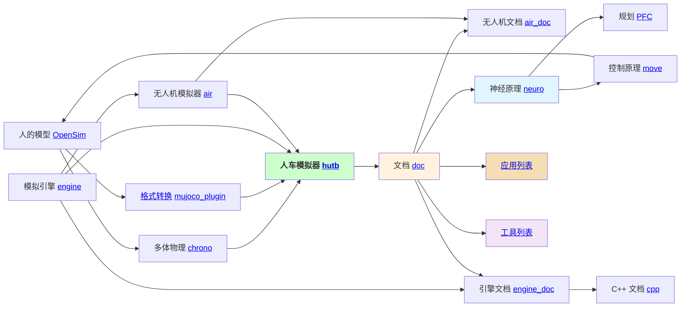
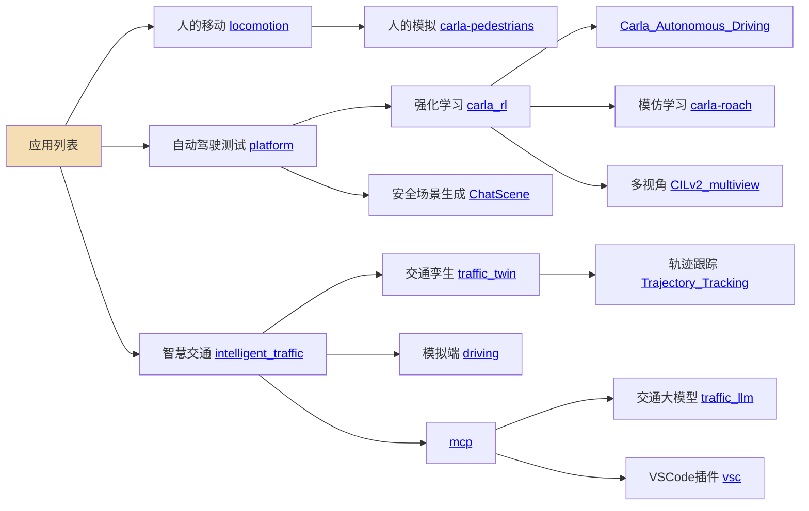
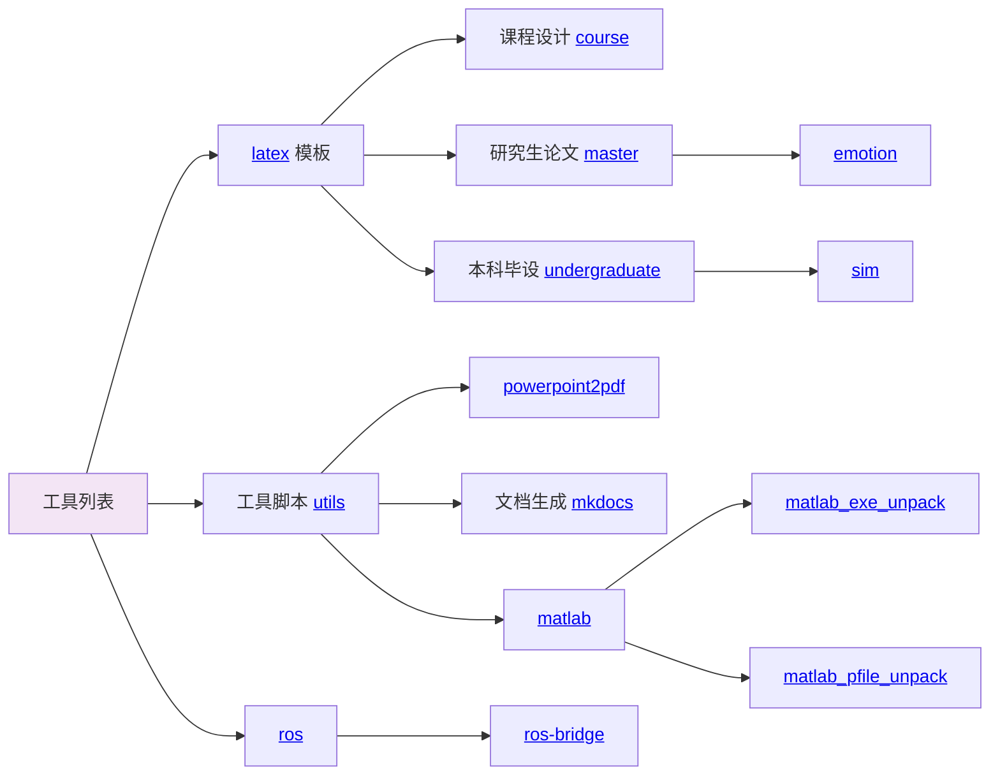

# OpenHUTB

OpenHUTB 简单来说是面向人机共生与智能载具研究、教学和开发的开源仿真社区，提供影视级物理模拟器、开放数字资产，以及感知、规划、控制和生成场景的工具。该社区具体提供一个包含人车代理（学术研究）、模拟器（技术开发包括数据驱动、机理仿真、界面渲染）、现实场景（艺术增强）的 [模拟器](https://openhutb.github.io) ，代理包括[感知](https://openhutb.github.io/doc/algorithms/perception/) （连接）、[规划](https://openhutb.github.io/doc/algorithms/planning/) （符号）、[控制](https://openhutb.github.io/doc/algorithms/control/) （行为）；模拟器包括Python与C++的接口（正向创建、反向构建）、LibCarla、虚幻引擎插件；现实场景包括 [静态场景孪生](https://openhutb.github.io/doc/adv_digital_twin/) 、[动态场景孪生](https://github.com/OpenHUTB/traffic_twin/) 。

以下为新手快速上手栏目：

[🚀 快速开始](https://github.com/OpenHUTB/hutb#使用示例) · [📖 在线文档](https://openhutb.github.io/) · [🧪 运行示例](https://github.com/OpenHUTB/doc/tree/master/src/examples) · [🤝 参与贡献](https://github.com/OpenHUTB/.github/blob/master/CONTRIBUTING.md) · [💬 提问与讨论](https://github.com/orgs/OpenHUTB/discussions)

你可以用 OpenHUTB 做什么？
- **研究与教学**：学习感知、规划、控制和具身智能算法。
- **仿真与验证**：在可重复的场景中开发、训练和验证算法。
- **场景与内容开发**：使用开放的城镇、建筑、车辆、行人和道具资产创建仿真环境。

核心入口

- 🟡 **[hutb 人车模拟器](https://github.com/OpenHUTB/hutb)** — 提供下载工具、Python API 和交通生成示例，目前持续开发中。
- 📚 **[doc 人车文档](https://github.com/OpenHUTB/doc)** — 提供安装、Python API、场景制作和开发文档。

### 研究与实验项目

- 🧪 **[traffic_twin 人车孪生](https://github.com/OpenHUTB/traffic_twin)** — 交通数字孪生相关研究和示例，使用前请查看仓库说明。
- 🧠 **[neuro 神经原理](https://github.com/OpenHUTB/neuro)** — 感知和神经网络相关研究内容。
- 🧭 **[PFC 规划](https://github.com/OpenHUTB/PFC)** — 规划相关研究内容。
- 🎮 **[move 控制原理](https://github.com/OpenHUTB/move)** — 运动控制与生物力学相关研究内容。

人车模拟器的技术架构如下图所示：

<!--所有项目关系的思维导图。-->
<!-- 使用markmap进行编辑并生成svg：https://markmap.js.org/repl -->
<!-- 在profile/markmap.md中去保存图的数据 -->
<!-- svg图片预览：https://raw.githack.com/ -->

## 社区项目之间的关系

### 应用列表

### 工具列表

## 文档贡献想法与计划

本节记录个人 fork 的文档贡献思路、检查结果和后续计划。向 OpenHUTB 提交的 PR 只包含教程链接修复。

### 对项目的理解

OpenHUTB 的 `.github` 仓库保存社区介绍、贡献流程和学习文档，通过 `mkdocs.yml` 构建文档网站。模拟器及其 Python API 的主要入口在 `hutb`、`doc` 等仓库。这个仓库中的 PyCharm 教程帮助初学者编写和运行 Python 程序，贡献指南则介绍 fork、分支、commit 和 PR 的流程。

### 贡献想法

先处理读者能直接遇到的教程入口问题：`docs/pycharm-tutorial.md` 的运行教程目录没有跳转目标，官网下载链接没有文字；`CONTRIBUTING.md` 中两处 PyCharm 链接把 `docs/` 写成了 `doc/`。这些问题可以通过检查源码和渲染页面确认，修复范围也较小，适合作为第一次文档贡献。

### 执行计划

1. 阅读 [贡献指南](CONTRIBUTING.md)，打开 [PyCharm 教程](docs/pycharm-tutorial.md)，亲自确认上述入口问题。
2. 查询上游已有 Issue 和 PR，确认没有相同修复后，用自己的账号提交 Issue，说明位置、复现方法和预期结果。
3. 在独立分支修复链接，检查生成页面的目录锚点、下载文字和目标路径，比较修改前后的构建告警。
4. 推送到个人 fork，再向 `OpenHUTB/.github` 的 `master` 分支提交仅包含文档修复的 PR，根据维护者反馈修改。

### 观察与思考

教程正文中已经有“如何运行 Pycharm？”这一节，但原来的目录项没有填写跳转目标；下载地址虽然写在源码中，链接文字却是空的。贡献指南里的两个 PyCharm 入口也都把 `docs/` 写成了 `doc/`。这几处问题会让初学者在找运行方法或安装软件时中断阅读，文档内容本身已经存在，入口却没有接好。

选择先修改这些链接，是因为问题的位置和正确目标都能确定，改动只有四行，也容易核对修改前后的差别。对第一次参与这个项目的人来说，从现有教程的小问题入手，可以先了解文档目录和贡献流程，再考虑更大范围的内容补充。

本次自动检查中，修改前后的普通 MkDocs 构建都完成了，仍然有六条相同的既有告警。修改后的页面还单独核对了五个目录锚点、下载链接文字、贡献指南的两个教程入口和十七张图片的文件路径。这个结果说明，构建完成只能说明页面生成了，入口能否正确跳转还需要另外检查；后续提交也应该记录具体检查了什么。

下一步准备检查贡献指南里的截图路径。`hooks.py` 会把根目录的 `CONTRIBUTING.md` 复制到 `docs/` 下，用于构建网站，同一段相对路径在 GitHub 仓库页面和文档站点中的起点可能不同。可以分别查看两种页面，记录存在问题的图片和对应文件，再按问题提交小范围的修复。
