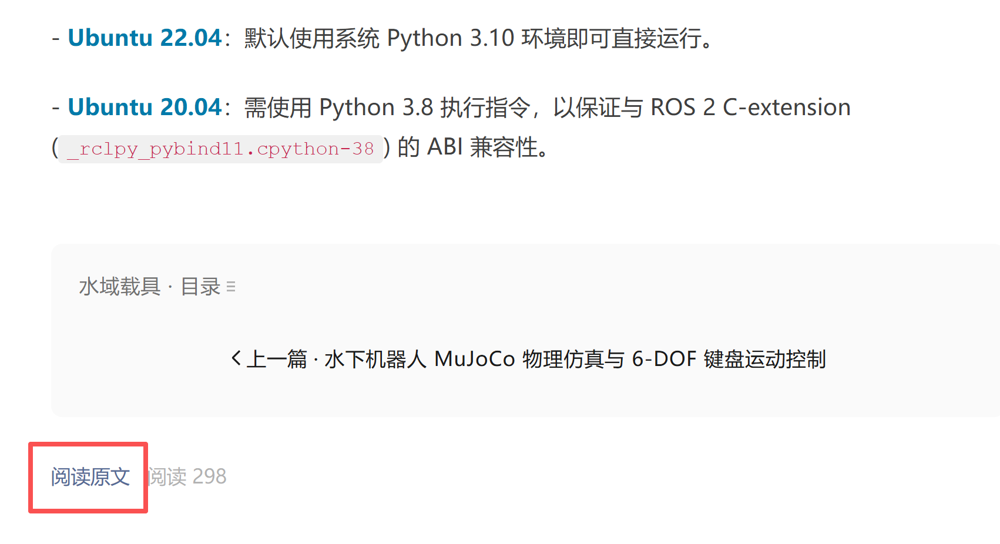
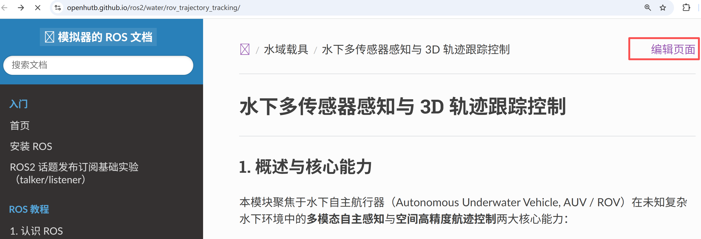
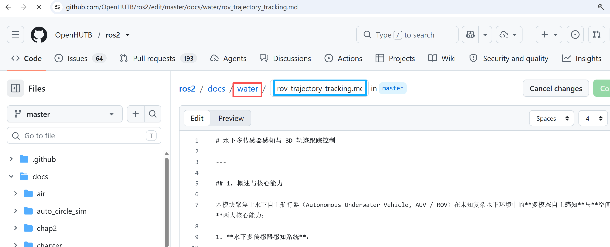
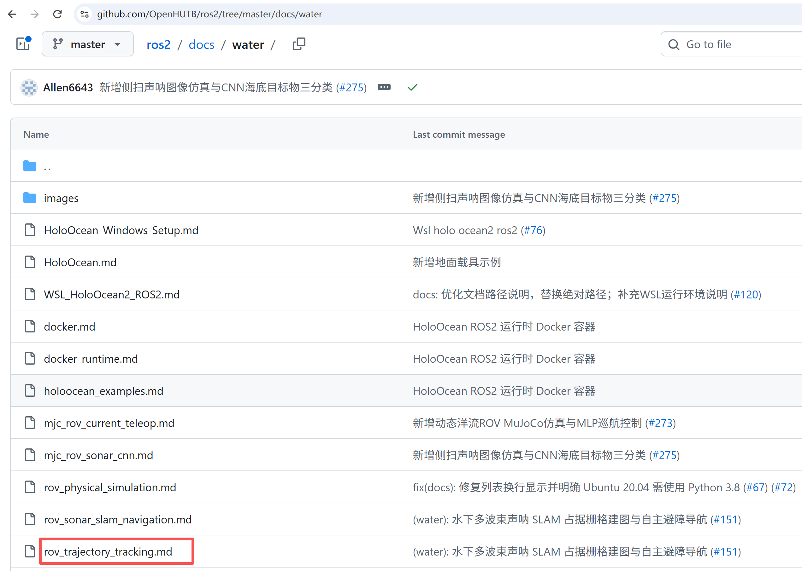
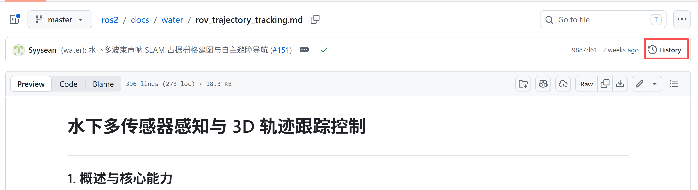
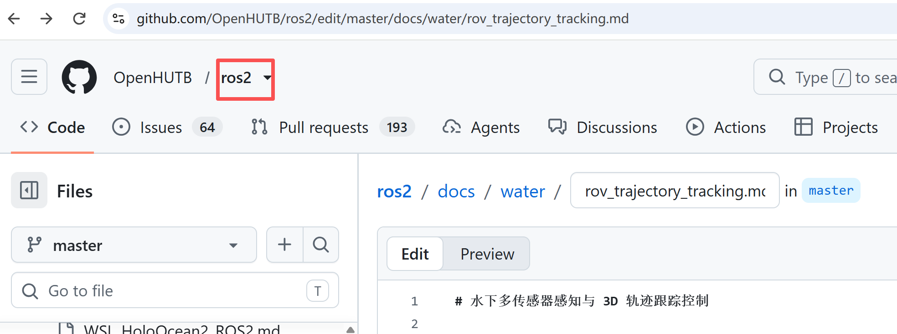
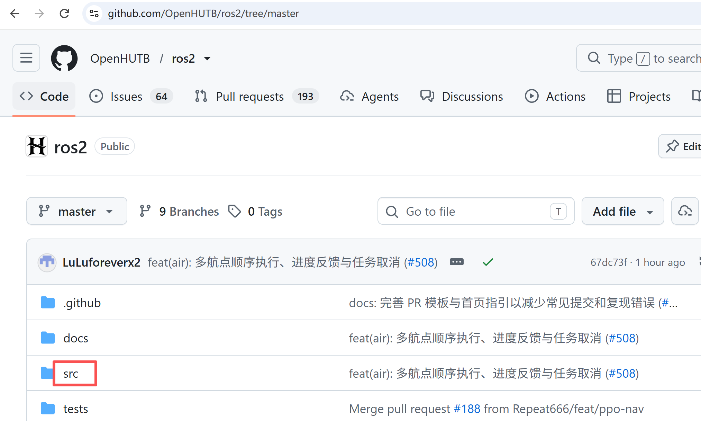
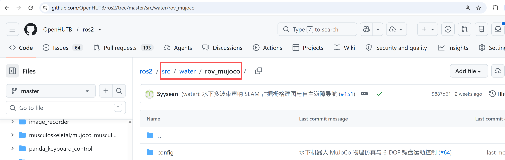

# 寻找社区技术文档所对应的作者和源码

该页面是为了解决当对某个文档页面有疑问想找到对应作者和源代码的问题。

## 寻找页面的作者

以[公众号文章](https://mp.weixin.qq.com/s/HS6_iq1081vJjsdgrta8wQ)为例，点击末尾“阅读全文”跳转到[文档页面](https://openhutb.github.io/ros2/water/rov_trajectory_tracking)。



然后，点击页面右上角的“编辑页面”，



将跳转到 github 仓库的代码编辑页面，点击它所在的文件夹：



点击上一步绿色框中的文件名（即页面所对应的 .md 文件）



点击页面右上角的`History`



将显示编辑过该页面的所有用户名（可能有多个）

### 用脚本一次看完（可选）

上面的 History 步骤也可以交给仓库里的脚本，它会把「最近几次提交、作者、GitHub 链接」一次打印出来：

```bash
python src/find_author.py docs/adv/find_author.md          # 仓库相对路径
python src/find_author.py /adv/find_author/                # 站点路径也可以
python src/find_author.py docs/adv/find_author.md --limit 10 --json   # 机器可读
```

本仓库的实际输出：

```text
文件: docs/adv/find_author.md

最近 3 次提交:
  9cb799a  2026-11-10  xy18574557330  docs: 修正寻找作者页面把文件路径写成“目录”的表述
  3cdb3f6  2026-10-28  DZ-djhy        删除「寻找作者和源码」页里失效的截图引用复制 (#373)
  bae8165  2026-10-25  donghaiwang    修复文字描述

作者（按提交数）: xy18574557330 (1), DZ-djhy (1), donghaiwang (1)

在浏览器中查看: https://github.com/OpenHUTB/.github/commits/master/docs/adv/find_author.md
逐行看是谁改的: https://github.com/OpenHUTB/.github/blame/master/docs/adv/find_author.md
```

## 寻找页面的源代码

以同一篇文章为例，从上面的“编辑页面”记下文档的路径 docs/water/rov_trajectory_tracking.md，点击仓库名进入仓库首页




代码位于 src 目录下与文档路径对应的子目录



该模块位于 src/water/rov_mujoco



最后一个目录可能有微小差别，具体请看上面提交历史（`History`）页面的详细信息。


