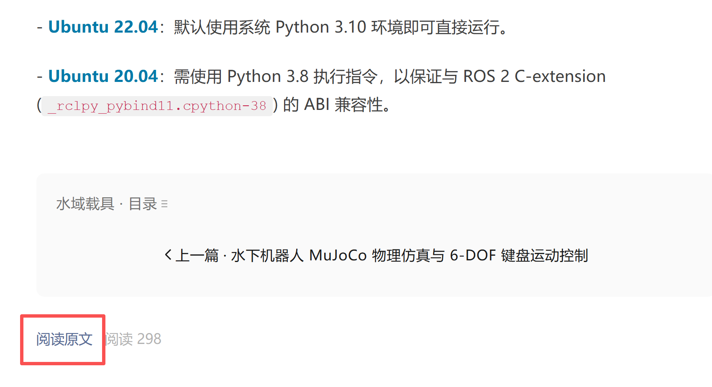
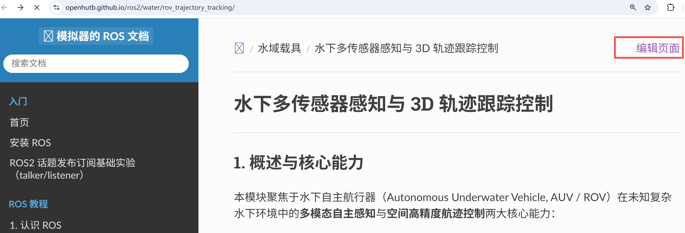
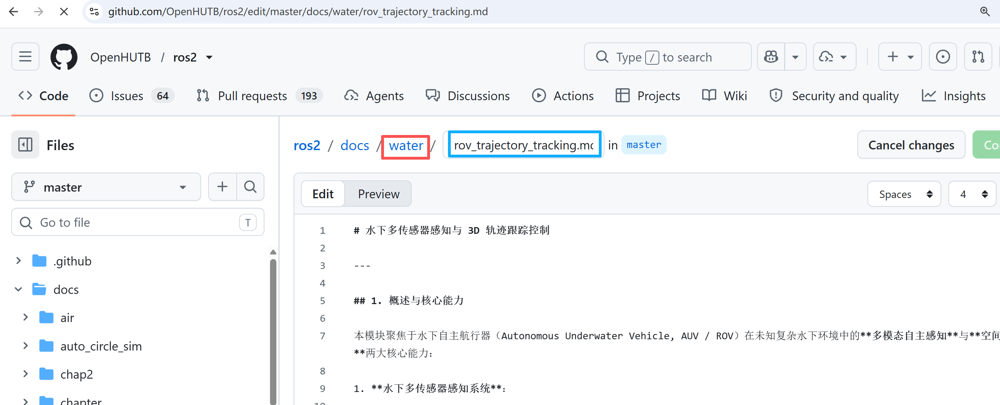
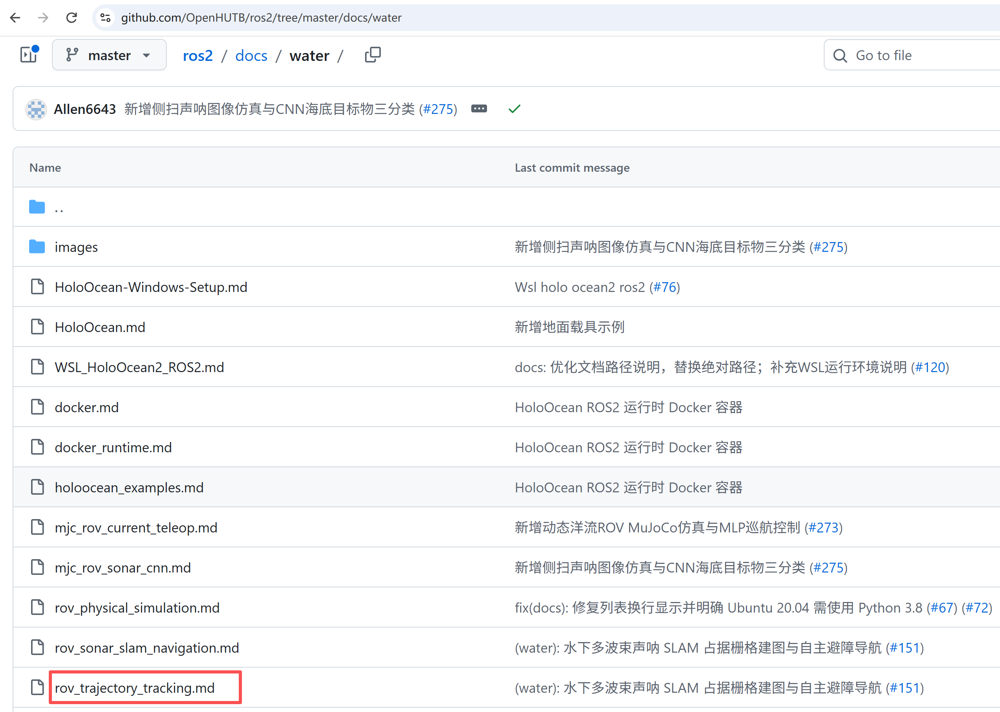
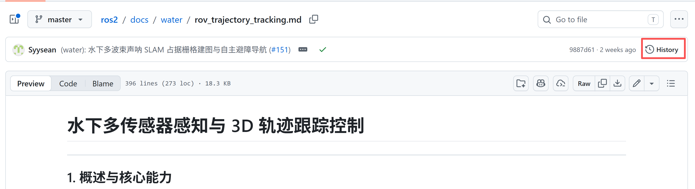
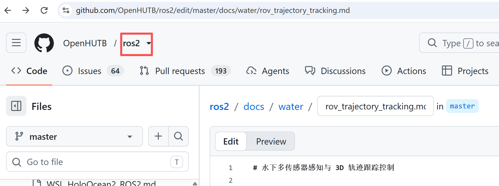
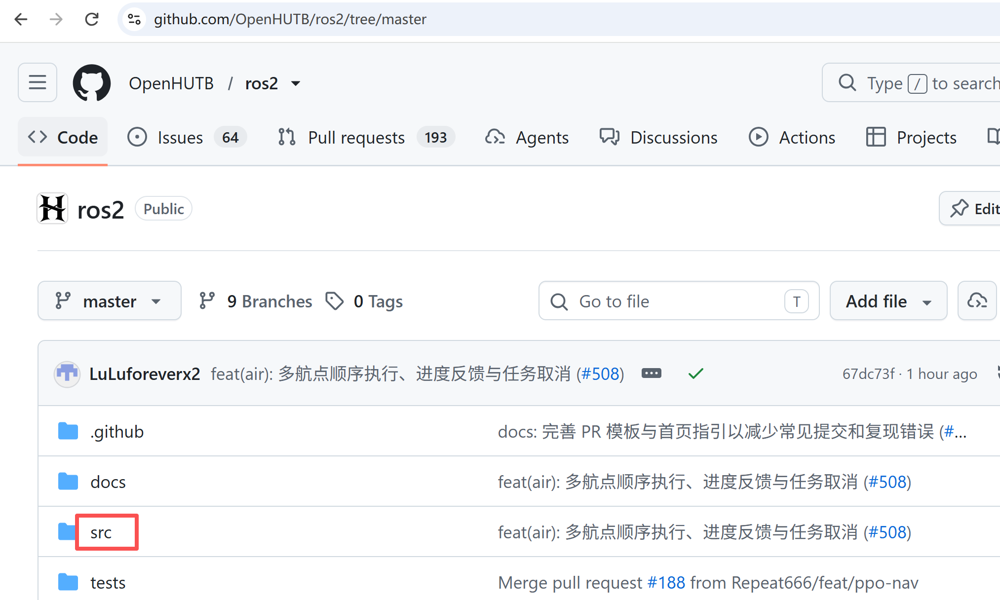
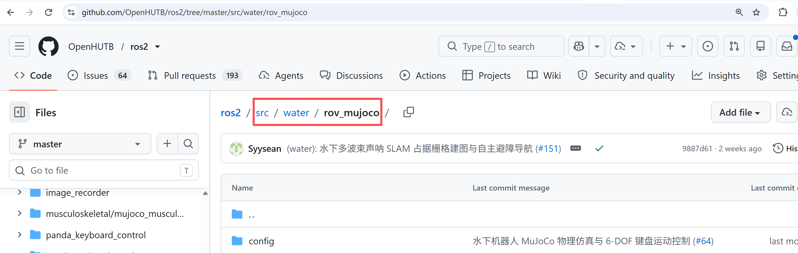

# 寻找社区技术文档所对应的作者和源码

该页面是为了解决当对某个文档页面有疑问想找到对应作者和源代码的问题。

## 寻找页面的作者

以[公众号文章](https://mp.weixin.qq.com/s/HS6_iq1081vJjsdgrta8wQ)为例，点击末尾“阅读全文”跳转到[文档页面](https://openhutb.github.io/ros2/water/rov_trajectory_tracking)。

然后，点击页面右上角的“编辑页面”，

将跳转到 github 仓库的代码编辑页面，点击它所在的文件夹：

点击上一步绿色框中的文件名（即页面所对应的 .md 文件）

点击页面右上角的`History`

将显示编辑过该页面的所有用户名（可能有多个）

## 寻找页面的源代码

以同一篇文章为例，从上面的“编辑页面”记下文档所在目录 docs/water/rov_trajectory_tracking.md，点击仓库名进入仓库首页

代码位于 src 目录下和文档相同的目录

该模块位于 src/water/rov_mujoco

最后一个目录可能有微小差别，具体请看上面提交历史（`History`）页面的详细信息。

