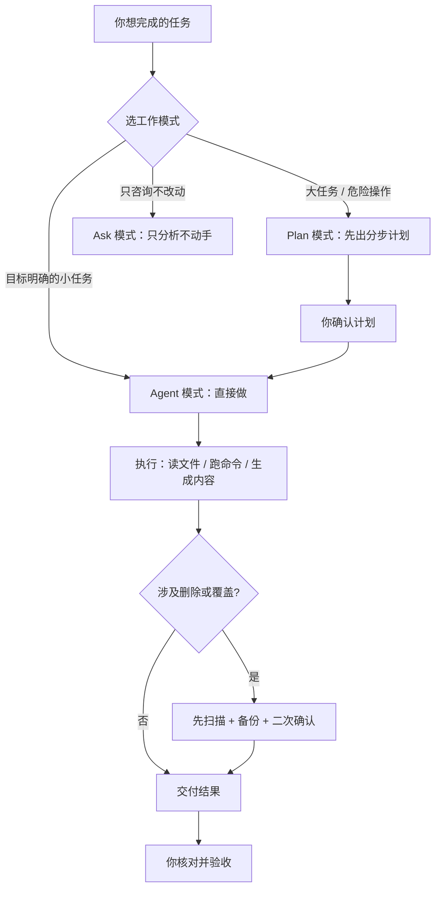

# 用 AI 助手接管电脑：处理文件与生成内容（教育指南）

> 一句话理解：把 AI 当作一位在你电脑上工作的「初级工程师」——它能读文件、跑命令、上网查资料、生成文档和代码，但**重大决策和危险操作仍由你拍板**。本文面向想把琐事交给 AI 处理、又不想把电脑搞乱的同学。

## 这是什么

近年来出现的 AI 编程助手 / 智能体（例如 WorkBuddy、Claude Code、Codex、Cursor 等），不再只是「聊天问答」，而是具备**工具调用能力**的助手：

- 读写你指定目录下的文件；
- 在沙箱或你的机器上执行命令（装依赖、跑测试、批处理）；
- 打开浏览器、操作页面、填表单；
- 联网检索、比对与核实信息；
- 生成 Markdown 报告、表格、PPT、网页、图表与代码。

它最适合做**目标明确、可验证、重复性高**的工作。它不替代你的判断：会出错、会遗漏、会「一本正经地编造」，所以核验环节不能省。

## 它能帮你做什么

- **文件批处理**：批量重命名、格式转换（如 CSV/JSON 互转）、从一堆文件里提取与汇总数据。
- **跑通与复现代码**：按 README 装环境、跑测试、定位并修复报错，把「别人能跑我跑不通」的活接过去。
- **生成内容**：写 Markdown 文档、整理表格、做 PPT 大纲、搭一个静态网页、画示意图。
- **数据处理与可视化**：清洗数据、统计指标、出图。
- **联网检索与核实**：查资料、跨源比对、验证事实。
- **定时自动化**：把周期性的脏活累活（如每日拉数据、每周出报告）交给定时任务。

> 真实例子：本指南就是 AI 在「Agent 模式」下，依据你给出的 PR 列表，实跑代码、生成审核报告后写成的——从「读仓库规范」到「出文档」一气呵成。

## 三种工作模式

- **Agent（你说我做）**：直接读写文件、执行命令、交付结果。适合目标清晰、范围可控的任务。
- **Plan（先想后做）**：先给出分步方案与影响评估，你确认后再执行。适合改动多、风险高的任务。
- **Ask（只答不动）**：只阅读、分析、回答，不改动任何文件。适合「帮我看看这段代码 / 这份数据有什么问题」。

## 上手准备

- **一个干净的工作目录**：新建专用文件夹放任务相关文件，**不要直接拿桌面、下载、文档当试验场**。
- **必要的运行环境**：按任务装 Python、Node 等依赖；能用虚拟环境 / 容器就用，避免污染系统。
- **网络与代理**：访问受限时准备好可用的代理或镜像源。
- **清晰的目标**：输入是什么、要什么输出、有哪些约束（格式、命名、语言、截止时间）。

## 给任务的正确姿势

1. **说清目标、输入、输出、约束**：比「写多一点」更重要的是「写清楚」。
2. **大任务拆成小步**：先让它做一个最小可验证的版本，再逐步扩展。
3. **先列计划再动手**：让它用 Plan 模式或先口头给出步骤，对齐后再执行。
4. **危险操作要二次确认**：凡涉及删除、覆盖、批量改名，要求它**先只读扫描**列出将影响哪些文件，你确认后再做。
5. **用真实数据佐证**：让它贴出实际运行的命令与输出、真实截图，而不是「据说能跑通」。

## 最小可复现示例

设想你有一堆实验日志 `data/*.csv`，想汇总成一张表并生成一份 Markdown 报告。可以这样交代任务：

> 请帮我处理 `data/` 下的所有 CSV（每个文件第一列是实验名，第二列是得分）。请：① 先只读列出将要读取的文件；② 汇总成一张总表；③ 生成 `report.md`，含总表与按得分排序的前三名；④ 不要删除或移动任何原始文件。

好的助手会先回你一份「将读取的文件清单」让你确认，再给出汇总结果与 `report.md`。全程不碰原始数据，出错也能回滚。

## 注意事项（务必先读）

!!! warning "动你的电脑文件要克制"
    - **个人目录高危**：桌面、下载、文档、主目录等不要交给它做批量删除或移动。先让它「只读扫描」列出待处理文件，你确认后再做。
    - **不可逆操作**：`rm -rf`、覆盖写、批量重命名都可能造成难以挽回的损失。要求它先**备份**（复制到安全位置）再**小批量**（每批不超过 10 个）执行，并优先用「回收站」而非直接删除。
    - **凭证与隐私**：不要把密码、Token、API Key、私钥粘贴进对话；不要在不可信环境暴露含敏感信息的文件。**令牌或密钥一旦粘贴出去即视为已泄露，要立即吊销重发。**
    - **权限边界**：Agent 模式能执行命令、改动文件。理解每条命令的后果，不要授予超出任务需要的权限。
    - **别盲信结果**：AI 会出错——路径写错、把二进制当文本解码、网络超时、甚至凭空编造文件内容。关键数据要自己复算或抽查，命令输出要亲自看一眼。
    - **版权与合规**：不处理侵权或违法内容；引用他人成果要注明出处，生成内容也要能追溯到来源。

## 温馨提示（用得更顺手）

!!! tip "把 AI 用成靠谱搭档"
    - 写清楚比写多更重要：目标、输入、输出、约束一次说清。
    - 善用 Plan 模式先对齐再执行，避免跑偏返工。
    - 破坏性操作坚持「先扫描、分批、二次确认」三原则。
    - 保留日志与备份，出错能回滚；大批量改动分批验证。
    - 用真实运行截图与数据支撑结论，而不是「应该没问题」。
    - 周期性的脏活累活，交给定时自动化，省下时间做判断。
    - 用中文交流即可；若产出要提交到社区仓库，按规范**声明 AI 使用情况**并对内容负责。

## 参考与延伸

- [文档修改指南](./submit.md) —— 如何向社区文档提修改
- [提问技巧](./ask_question.md) —— 怎么把问题说清楚
- [注意事项](./note.md) —— 提交与审核的通用注意点
- [开源工具列表](./tools.md) —— 社区常用开源工具

## 大模型使用声明

本指南由 AI（WorkBuddy）辅助撰写，作者已逐项复核并对内容负责。
