# 基于浏览器的贡献指南

## 1. Fork 仓库

**[注册](https://openhutb.github.io/.github/dev/sign_up/) 并登录 Github 账号**，在 [想要修改的开源孪创仓库](https://github.com/OpenHUTB/hutb) 页面右上角点击`Fork`

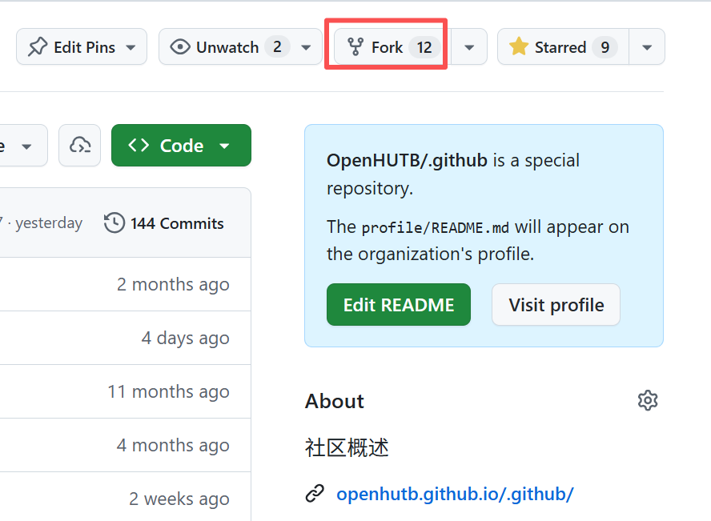

在弹出的页面点击`Create fork`，**创建分叉**到个人仓库。

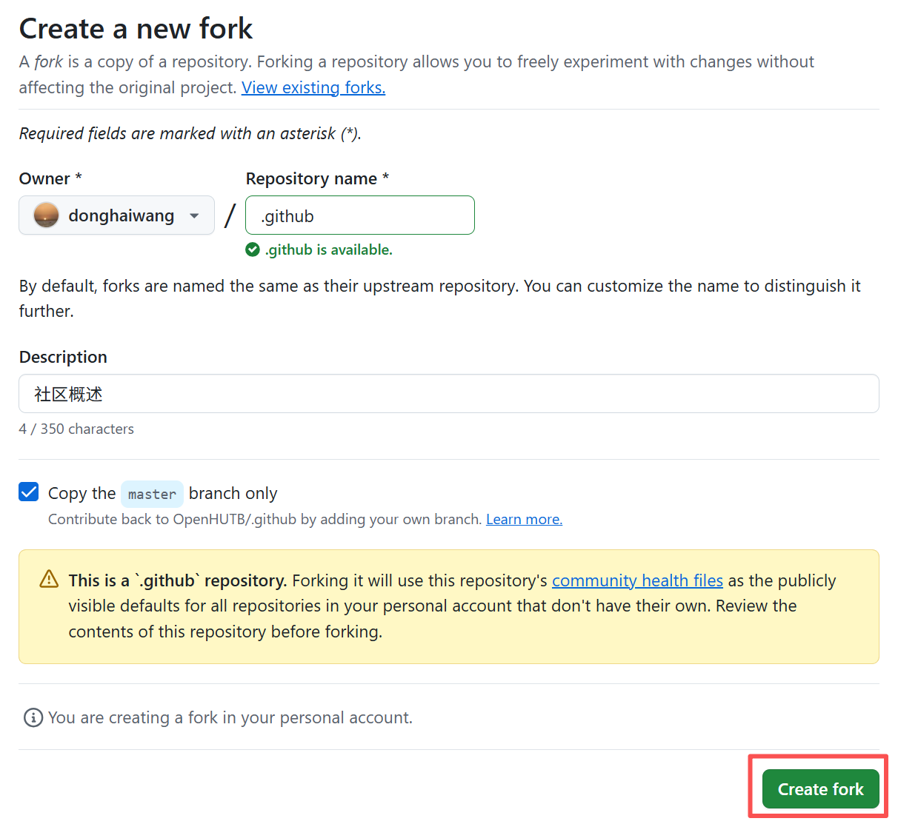

出现的页面即为社区仓库的拷贝。

## 2. 启用自动化流水

点击个人项目的“Actions -> I understand my workflows, go ahead and enable them”启用自动化流水。

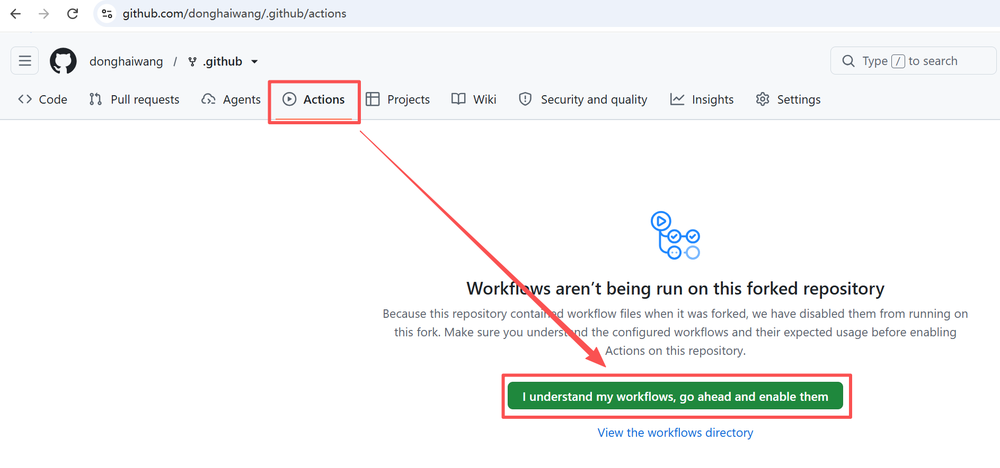

点击“Settings -> Action -> General -> Workflow permissions -> read and write permissions” 启用项目的 Action 写入权限。

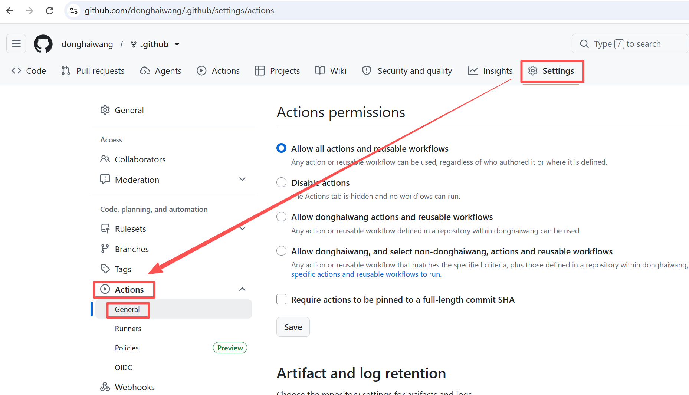

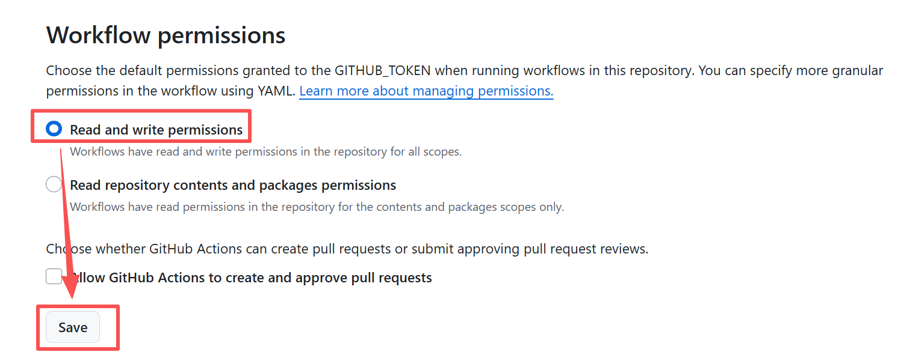

## 3. 修改项目

点击“Code -> Create codespace on master”创建在线编辑器
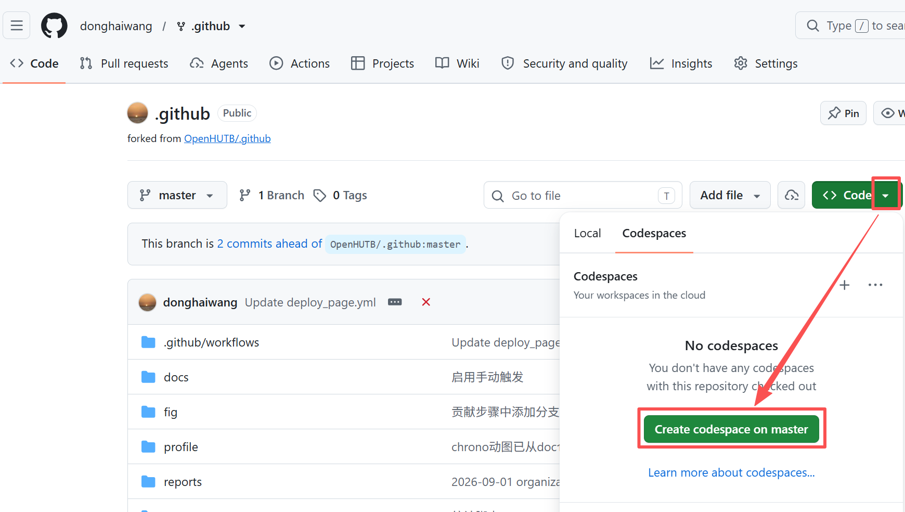

等待一会儿，就可以在浏览器中显示 VSCode 编辑器打开的项目，点击“信任文件并继续”

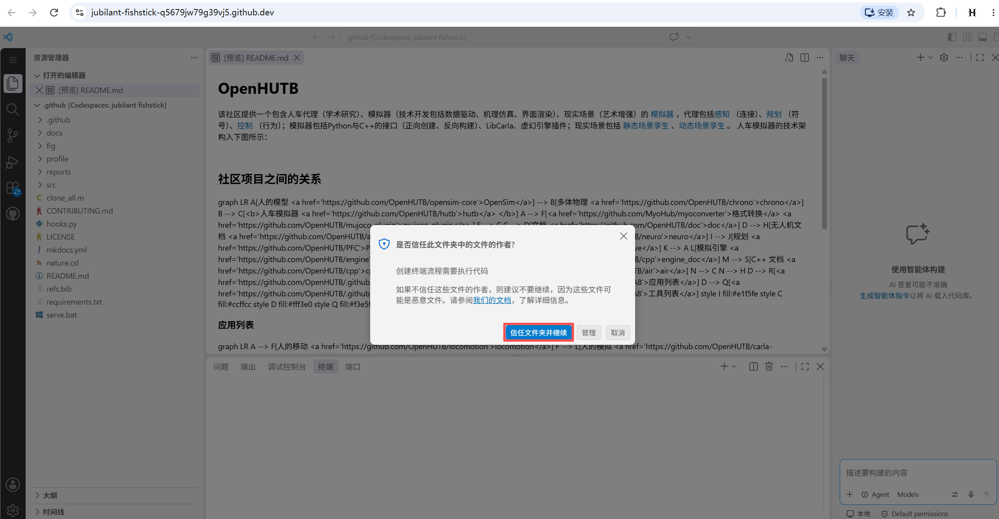

在开始编辑前，建议先从 `master` 创建独立的特性分支，避免将本次修改直接提交到主分支。点击 VS Code 左下角的当前分支名，选择 **Create new branch...**，输入简短且能说明改动的分支名（例如 `docs/update-guide`），并确认状态栏已切换到新分支后再编辑文件。

点击左边“资源管理器”中的文件，并在中间进行编辑。点击编辑区右上角的“Open Preview to the side”来打开修改的预览

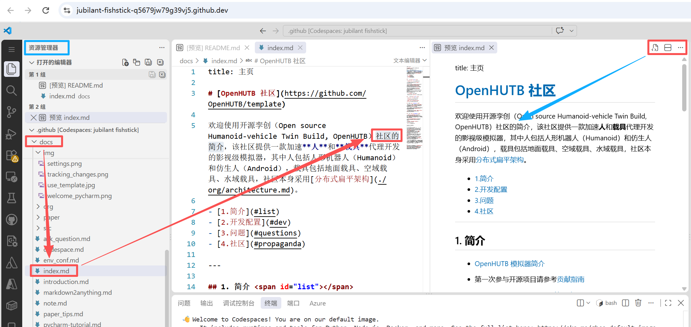

编辑完成后，按 `Ctrl+S` 保存文件，并通过预览检查内容和排版。保存只会更新当前 Codespace 中的文件，还需要按照下一步完成“提交”和“同步更改”，才能将修改上传到个人 GitHub 仓库。

## 4. 提交修改

点击左侧分叉图标的“源代码管理”，弹出提交页面。
点击更改的内容，确认中间的工作树对比中（左侧为修改之前的内容，右侧为修改之后的内容）的修改为想要修改的内容。再填写提交信息，点击“提交”。

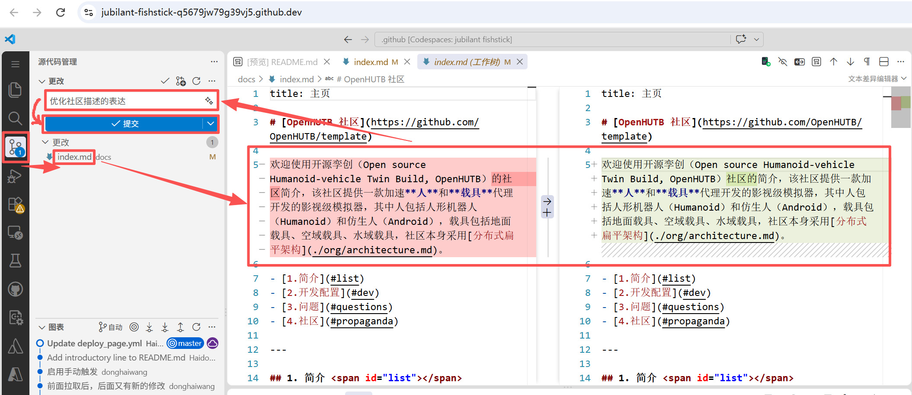

然后点击“同步更改”，将提交推送到个人仓库的当前特性分支（例如 `origin/docs/update-guide`）。这时左侧“图表”中多了一项刚才提交的内容。

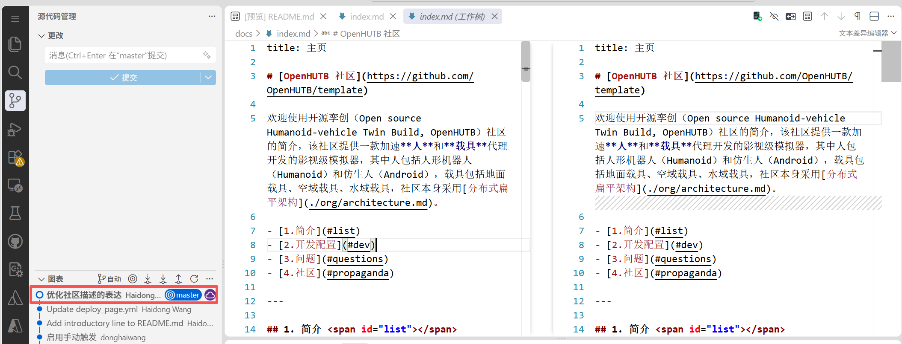

## 5. 检查修改内容的正确性

回到仓库页面，发现有内容领先于开源孪创社区分支（commits ahead of OpenHUTB/.github:master）

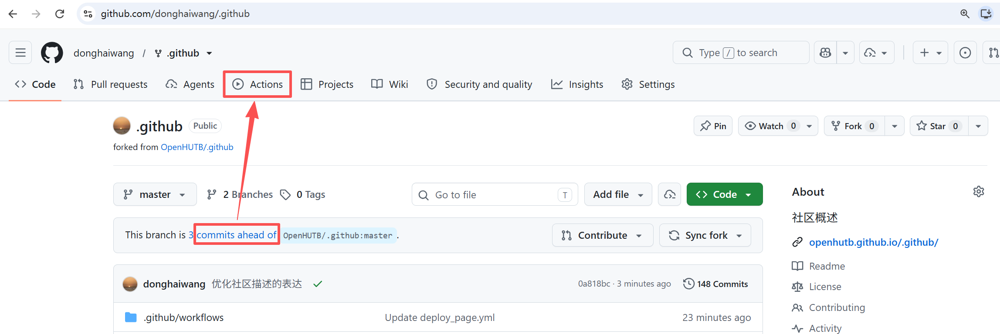

提交并同步后，进入个人仓库的 Actions 页面，查看对应本次提交的运行记录。黄色表示任务尚未完成，绿色勾表示成功，红色叉表示失败。如果运行失败，点击该记录，进入失败的任务并展开报错步骤，根据日志中的具体错误排查。

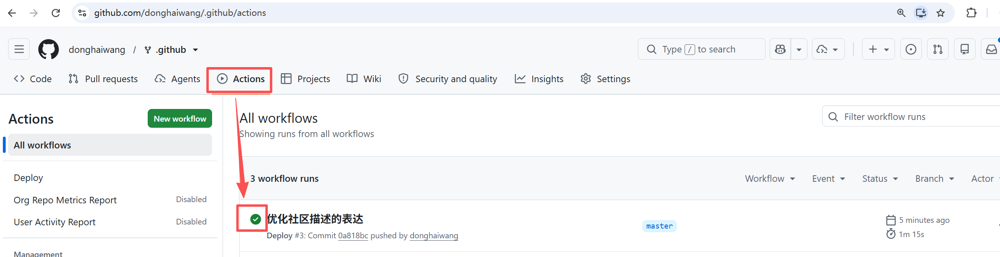

点击“Settings -> Pages -> Branch -> None -> gh-pages -> Save” 部署生成的 gh-pages 分支（网页文件），该步骤只需要执行一次
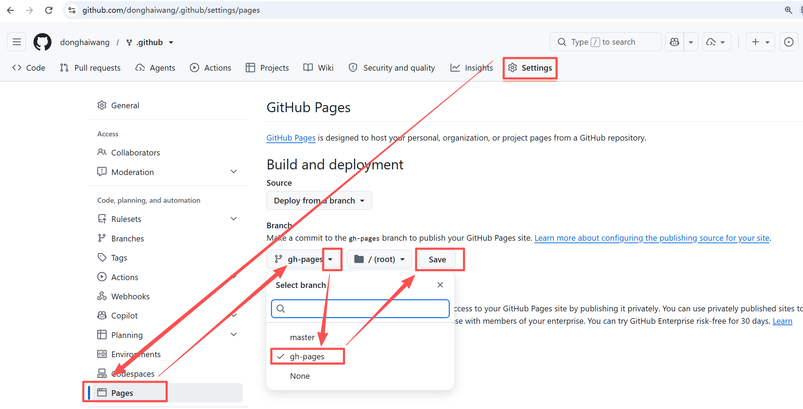

点击“Actions”查看部署链接：

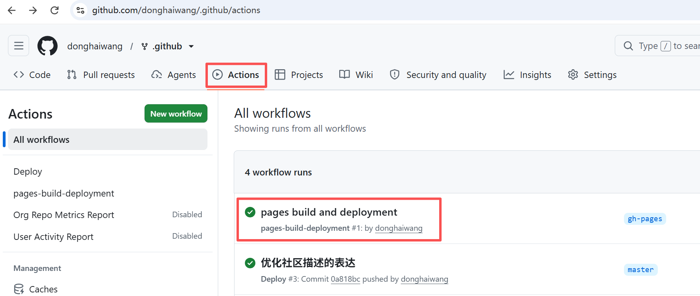

点击部署的链接（后面部署该链接都不变）

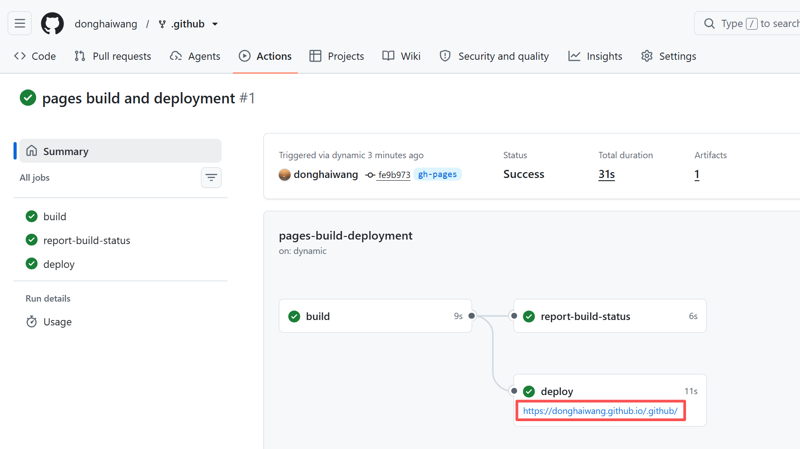

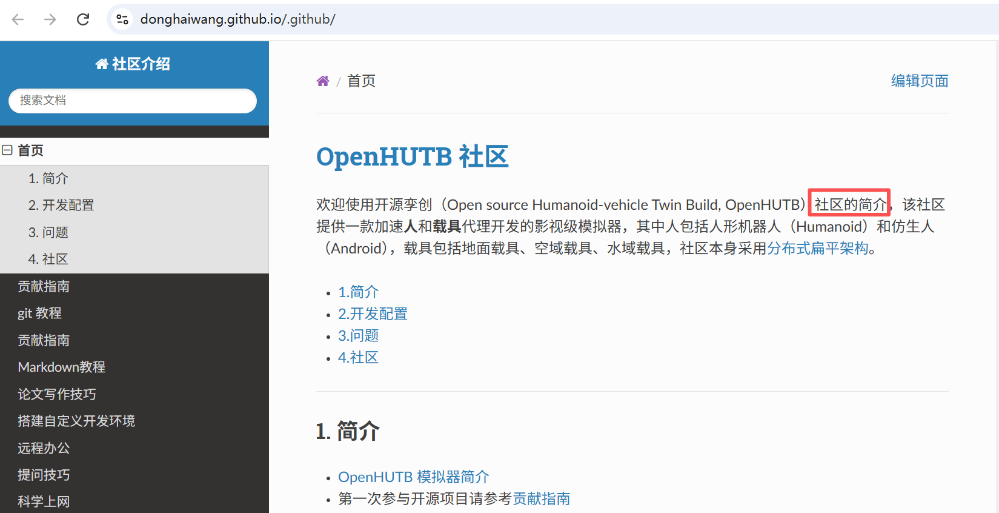

## 6. 创建 Pull Request

在项目主页点击“Contribute -> Open pull request”

填写 PR 时，确认 base repository 是社区的目标仓库、base branch 是目标分支（例如 `OpenHUTB/hutb:master`），head repository 是个人 fork、head branch 是刚创建的特性分支。这样 PR 会指向社区仓库，而不是个人 fork 的主分支。

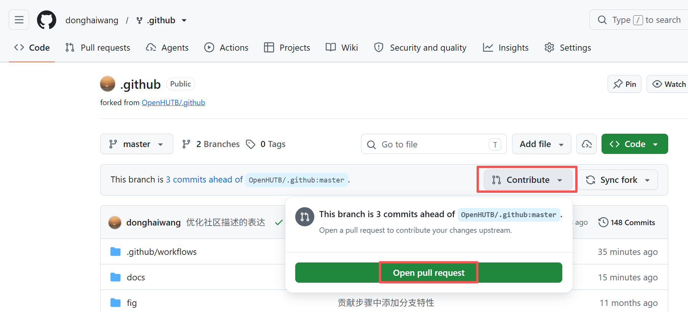

填写标题和详细描述信息，点击“Create pull request”

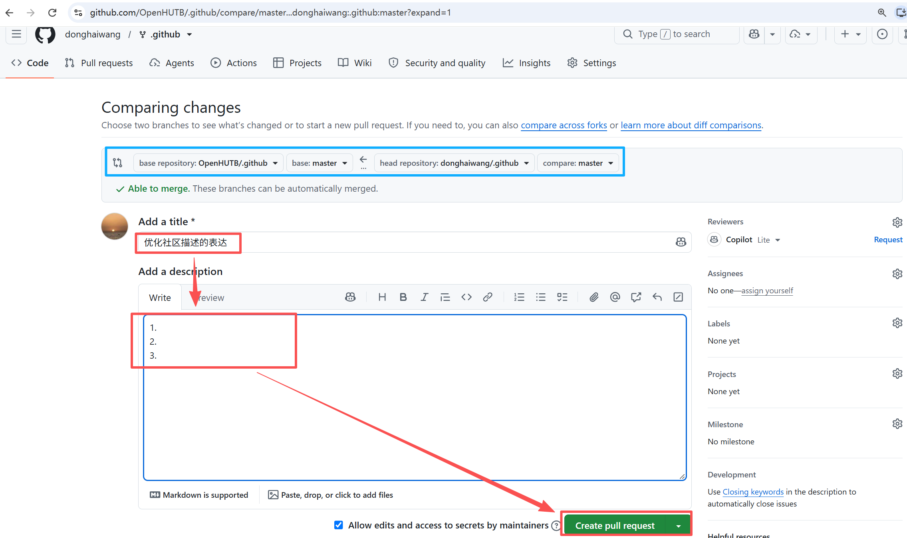

将会跳转到社区仓库的 Pull Request 页面，等待其他人评论。如果其他人提出问题，则返回[第 3 步“修改项目”](#3-修改项目)继续在 VSCode 中编辑。如果没问题，则会通过并合并到主分支，随后就可以在社区的代码库和页面中看到修改的内容。

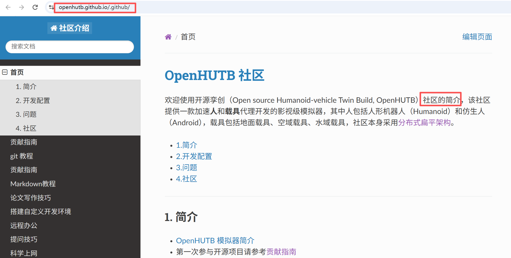

如果 Pull Request 尚未合并且保持打开状态，收到审核意见后，应在创建该请求时使用的分支上继续修改，完成提交并同步。新的提交会自动追加到原 Pull Request，无需重复创建。同步后可在原请求的 Commits 中确认提交记录，并在 Files changed 中检查最终修改内容。

## 暂时离开与下次继续

关闭浏览器标签页并不会立即停止 Codespace，它会继续运行，直到空闲超时。结束本次编辑时，先保存文件，并把需要上传的修改提交、同步到个人仓库，再到 [Codespaces 列表](https://github.com/codespaces)，找到对应环境，点击 `… → Stop codespace`。确认状态变为已停止后再离开。

下次继续时，在同一列表中打开原来的 Codespace，即可恢复已保存的文件；之前运行的预览服务等进程需要重新启动。停止环境不会把尚未推送的提交上传到 GitHub，提交后仍应在仓库页面检查记录。

停止后不再产生该环境的计算用量，但保存环境仍会占用存储额度。只打算暂时离开时选择停止，长期不用时可在确认所需内容已推送或备份后再决定是否删除。

操作说明见 [GitHub：停止和启动 Codespace](https://docs.github.com/zh/codespaces/developing-in-a-codespace/stopping-and-starting-a-codespace)。

## 离开前的检查

结束编辑前，请确认文件已保存，并查看待提交文件列表；需要稍后继续时，记下当前分支和最后一次提交。这样重新打开环境后，可以从同一位置继续处理。
