# 基于浏览器的贡献指南
本指南介绍如何通过GitHub Codespaces（基于浏览器的在线开发环境）为OpenHUTB项目做贡献
## 1. Fork 仓库

**[注册](https://openhutb.github.io/.github/dev/sign_up/) 并登录 GitHub 账号**，在 [想要修改的开源孪创仓库](https://github.com/OpenHUTB/hutb) 页面右上角点击`Fork`

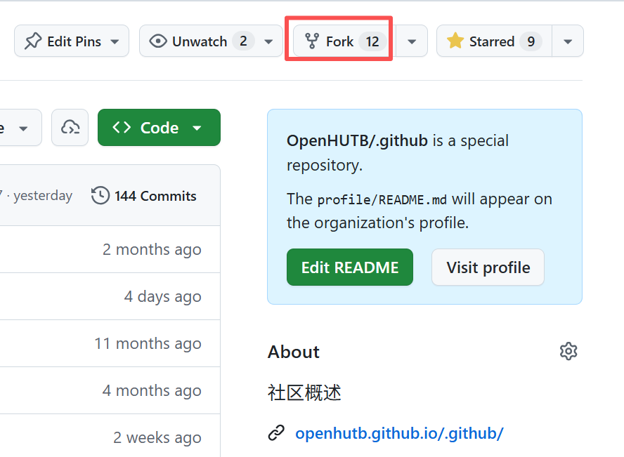

在弹出的页面点击`Create fork`，**创建分叉**到个人仓库。

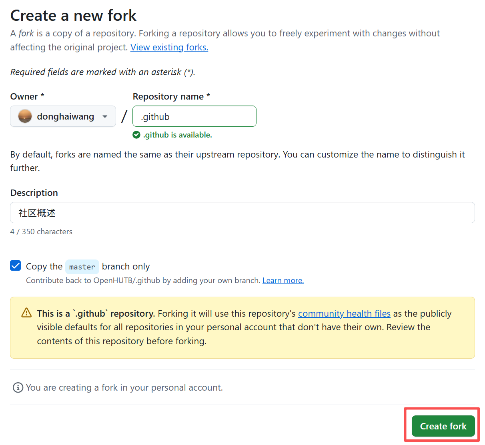

出现的页面即为社区仓库的拷贝。

## 2. 启用自动化流水线

点击个人项目的“Actions -> I understand my workflows, go ahead and enable them”启用自动化流水线。
首次进入你 fork 仓库的 Actions 页面时，会看到一个提示框，点击绿色的启用按钮即可
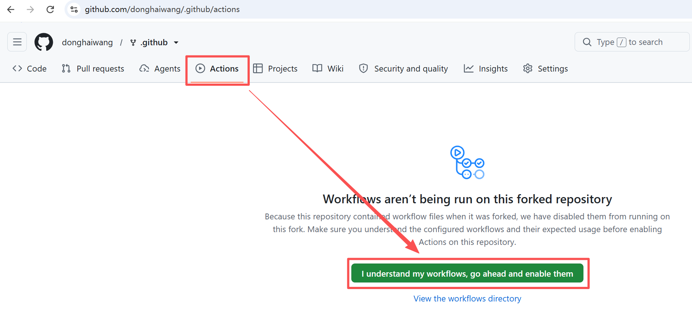


点击“Settings -> Actions -> General -> Workflow permissions -> read and write permissions” 启用项目的 Action 写入权限。

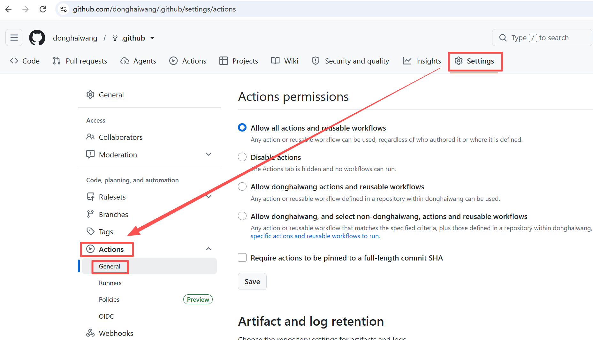

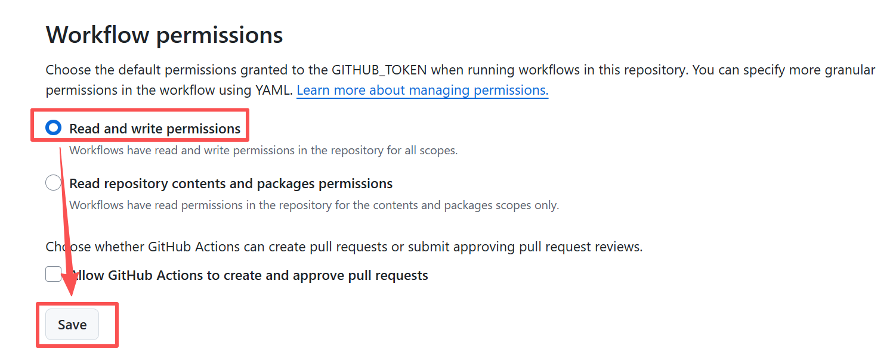

## 3. 修改项目

点击“Code -> Create codespace on master”创建在线编辑器
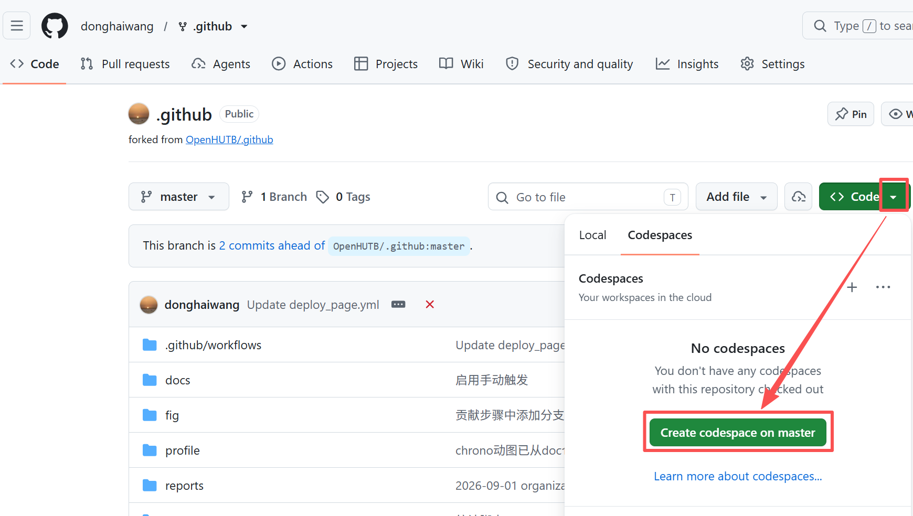

等待一会儿，就可以在浏览器中显示 VSCode 编辑器打开的项目，点击“信任文件并继续”

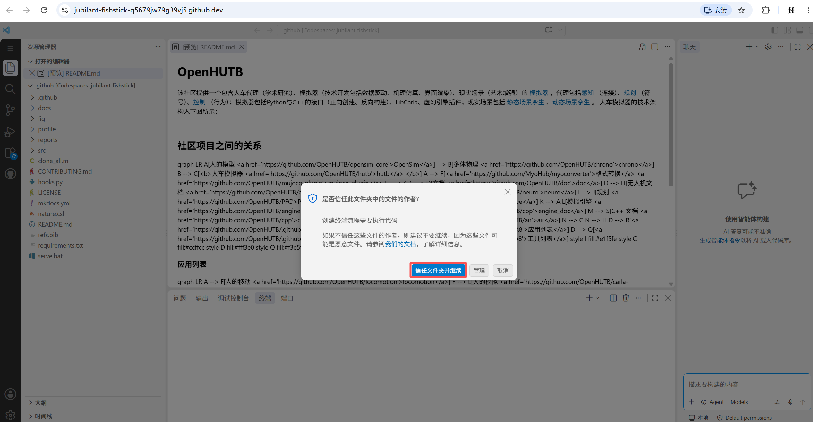

在开始编辑前，建议先从 `master` 创建独立的特性分支，避免将本次修改直接提交到主分支。点击 VS Code 左下角的当前分支名，选择 **Create new branch...**，输入简短且能说明改动的分支名（例如 `docs/update-guide`），并确认状态栏已切换到新分支后再编辑文件。


点击左边“资源管理器”中的文件，并在中间进行编辑。点击编辑区右上角的“Open Preview to the side”来打开修改的预览

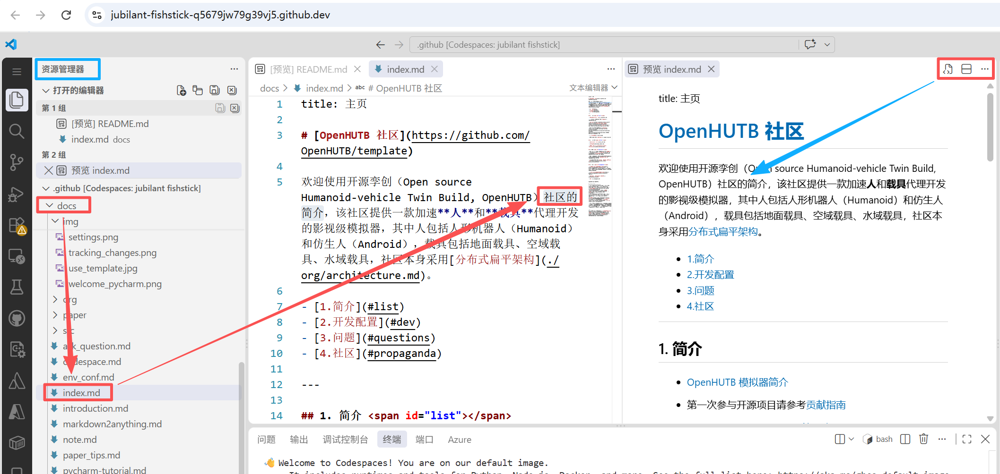

编辑完成后，按 `Ctrl+S` 保存文件，并通过预览检查内容和排版。保存只会更新当前 Codespace 中的文件，还需要按照下一步完成“提交”和“同步更改”，才能将修改上传到个人 GitHub 仓库。

### 在 Codespace 中预览完整文档网站

编辑器侧边的 Markdown 预览适合检查段落和列表。修改导航、公式或站点插件相关内容时，还应启动项目的 MkDocs 网站，检查实际页面。本节以 `OpenHUTB/.github` 文档仓库为例。

打开终端，进入同时包含 `mkdocs.yml` 和 `requirements.txt` 的仓库根目录，然后执行：

```shell
python -m venv .venv
source .venv/bin/activate
python -m pip install mkdocs -r requirements.txt
python -m mkdocs serve --dev-addr 0.0.0.0:8000
```

这里的激活命令适用于 Codespaces 常见的 Linux 终端；已建好 `.venv` 时只需重新激活，不必重复创建。安装依赖后，等待终端出现服务启动信息，再打开底部的“端口（Ports）”标签页：

1. 找到 `8000` 端口；未自动出现时，点击“添加端口”并输入 `8000`。
2. 点击该端口的“在浏览器中打开”。保留端口的专用可见性即可，个人检查无需公开端口。
3. 从网站导航进入本次修改的页面，检查图片、站内链接、公式和目录。保存源文件后，等待构建完成，再刷新页面确认变化。

此时应使用端口面板提供的转发地址；个人电脑的 `localhost:8000` 并不是 Codespace 的地址。若配置中的 `site_url` 带有子路径，终端给出的访问路径可能也带有该前缀，应保留完整路径。

检查结束后，在运行服务的终端按 `Ctrl+C` 停止。这个预览地址只在服务运行期间可用；正式发布后的固定地址仍按第 5 步检查。站点输出目录 `site/` 和 `.venv/` 不加入本次提交。

命令说明见 [MkDocs：开发服务器地址](https://www.mkdocs.org/user-guide/configuration/#dev_addr)，端口操作见 [GitHub：转发 Codespaces 端口](https://docs.github.com/zh/codespaces/developing-in-a-codespace/forwarding-ports-in-your-codespace)。

## 4. 提交修改

点击左侧分叉图标的“源代码管理”，弹出提交页面。
点击更改的内容，确认中间的工作树对比中（左侧为修改之前的内容，右侧为修改之后的内容）的修改为想要修改的内容。再填写提交信息，点击“提交”。

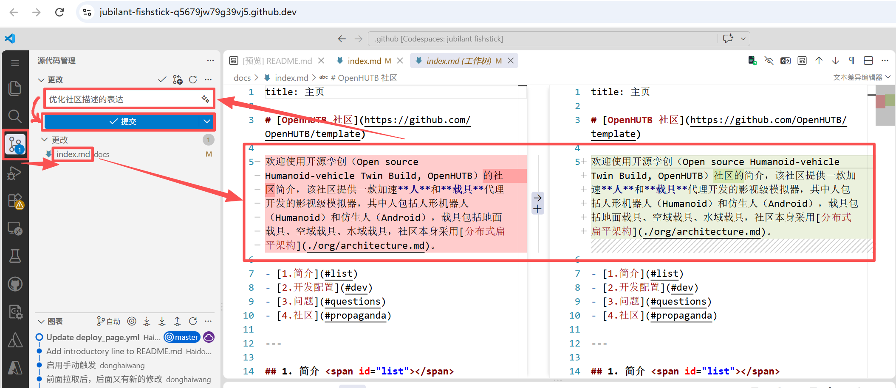

然后点击“同步更改”，将提交推送到个人仓库的当前特性分支（例如 `origin/docs/update-guide`）。这时左侧“图表”中多了一项刚才提交的内容。


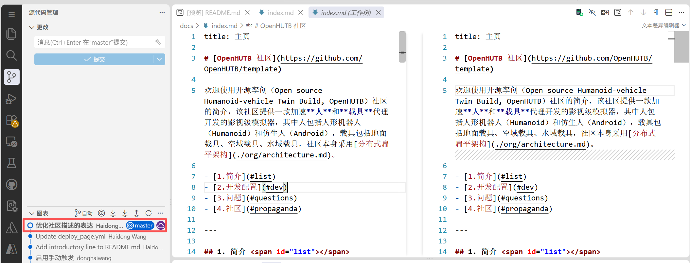


## 5. 检查修改内容的正确性

回到仓库页面，发现有内容领先于开源孪创社区分支（commits ahead of OpenHUTB/.github:master）

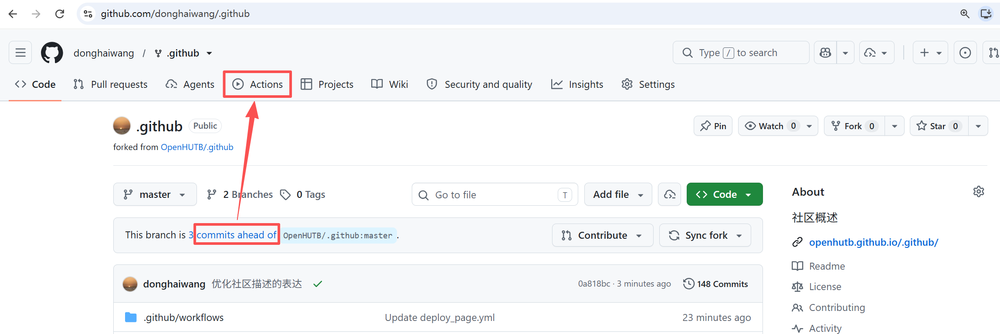

提交并同步后，进入个人仓库的 Actions 页面，查看对应本次提交的运行记录。黄色表示任务尚未完成，绿色勾表示成功，红色叉表示失败。如果运行失败，点击该记录，进入失败的任务并展开报错步骤，根据日志中的具体错误排查。

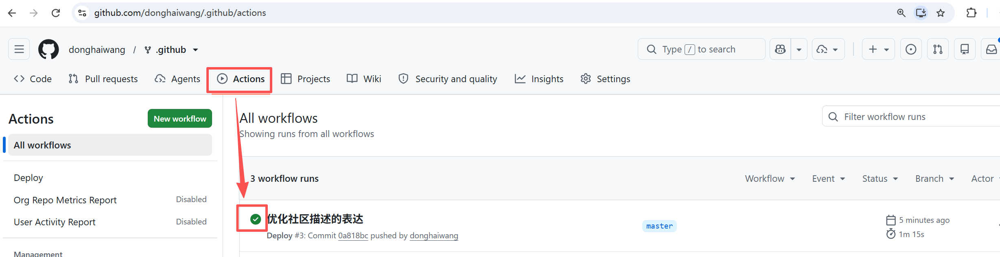

点击“Settings -> Pages -> Branch -> None -> gh-pages -> Save” 部署生成的 gh-pages 分支（网页文件），该步骤只需要执行一次
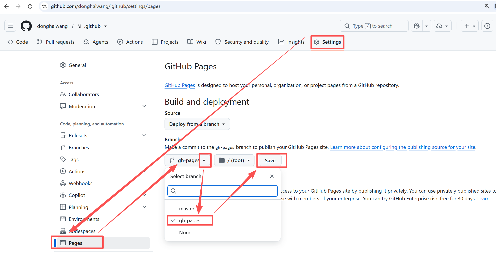

点击“Actions”查看部署链接：

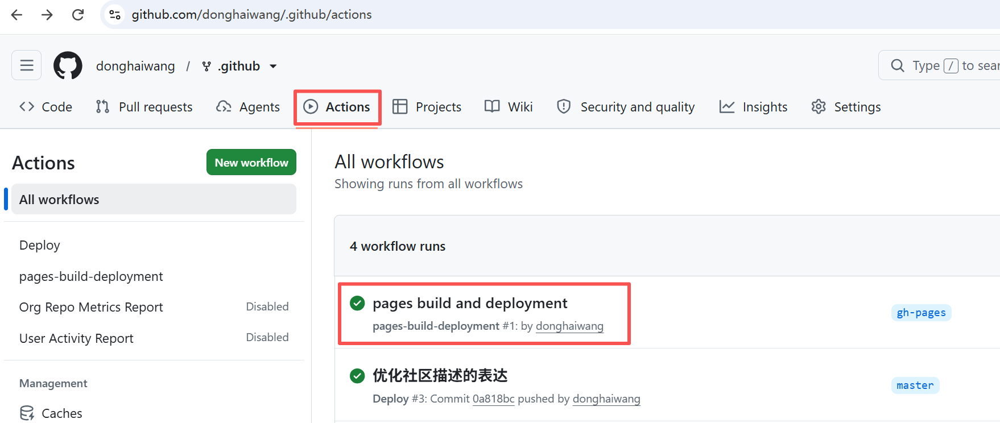

点击部署的链接（后面部署该链接都不变）

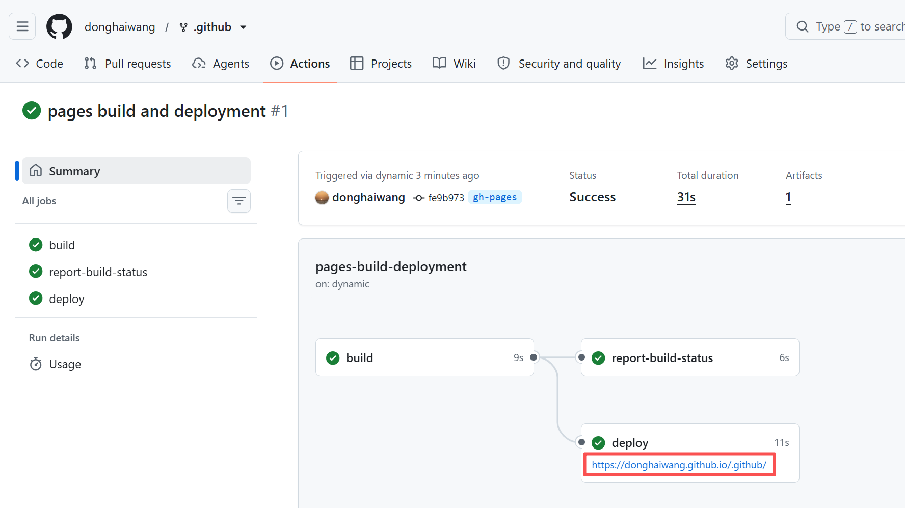

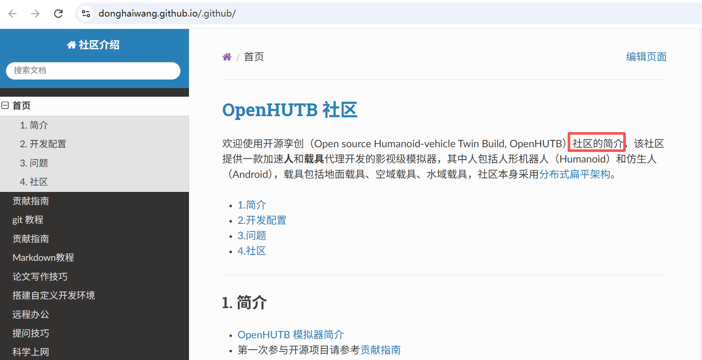


## 6. 创建 Pull Request

在项目主页点击“Contribute -> Open pull request”

填写 PR 时，确认 base repository 是社区的目标仓库、base branch 是目标分支（例如 `OpenHUTB/hutb:master`），head repository 是个人 fork、head branch 是刚创建的特性分支。这样 PR 会指向社区仓库，而不是个人 fork 的主分支。


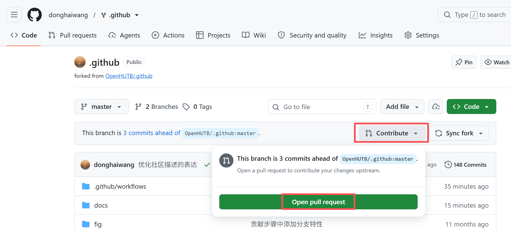

填写标题和详细描述信息，点击“Create pull request”

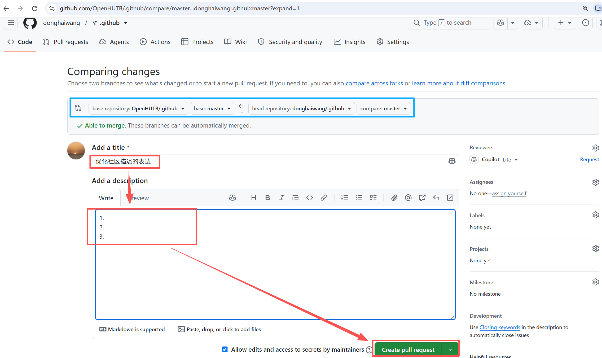

将会跳转到社区仓库的 Pull Request 页面，等待其他人评论。如果其他人提出问题，则返回[第 3 步“修改项目”](#3-修改项目)继续在 VSCode 中编辑。如果没问题，则会通过并合并到主分支，随后就可以在社区的代码库和页面中看到修改的内容。

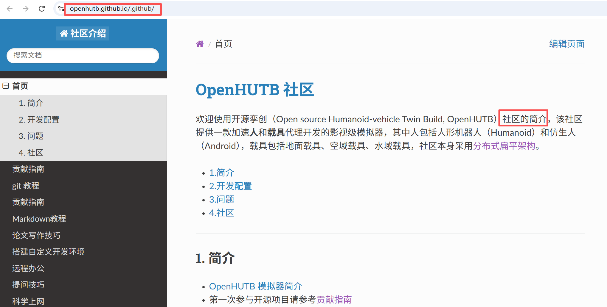

如果 Pull Request 尚未合并且保持打开状态，收到审核意见后，应在创建该请求时使用的分支上继续修改，完成提交并同步。新的提交会自动追加到原 Pull Request，无需重复创建。同步后可在原请求的 Commits 中确认提交记录，并在 Files changed 中检查最终修改内容。


## 暂时离开与下次继续

关闭浏览器标签页并不会立即停止 Codespace，它会持续运行直到空闲超时。结束编辑时，请先保存文件，将改动提交并推送到个人仓库，再进入 [Codespaces 列表](https://github.com/codespaces)，找到对应环境，点击 `… → Stop codespace`，确认状态变为已停止再离开。

> ⚠️ 停止不会自动推送代码。

下次继续时，在列表打开原有 Codespace，已保存文件可以恢复；之前运行的预览服务等进程需要重新启动。

停止后不再消耗算力，但依旧占用存储额度；长期不用，确认代码已备份推送后，可以删除环境释放空间。

操作说明见 [GitHub：停止和启动 Codespace](https://docs.github.com/zh/codespaces/developing-in-a-codespace/stopping-and-starting-a-codespace)。


## 重进 Codespace 后的检查步骤
重新进入 Codespace 后，在终端依次执行检查：
- 执行 `git branch --show-current`，确认当前分支和 PR 来源分支一致。
- 执行 `git status --short`，核对变更文件列表，确认均为本次待处理内容。
- 执行 `git diff` 查看未暂存修改；再执行 `git diff --cached` 查看已暂存修改。两处核对无误后，再进行编辑、提交与推送。

若分支、变更文件和预期不一致，先梳理现有修改，妥善留存需要保留的内容，再继续操作。

## 离开前的检查

结束编辑前，请确认文件已保存，并查看待提交文件列表；需要稍后继续时，记下当前分支和最后一次提交。这样重新打开环境后，可以从同一位置继续处理。
