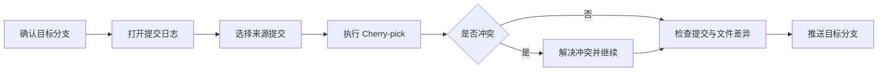

# 合并提交

## 摘取提交（Cherry-pick）

摘取提交用于把一个分支中的指定提交复制到当前分支。开始前先区分两个对象：

- **来源分支**：包含需要复用的提交。
- **目标分支**：接收这些提交，也是执行摘取操作时应切换到的分支。

## 使用 TortoiseGit 操作

1. 确认工作区没有未保存或未提交的修改。
2. 在 TortoiseGit 中切换到接收修改的目标分支。
3. 打开提交日志，找到来源分支中需要摘取的一个或多个提交。
4. 按实际依赖关系选择提交并调整顺序，右键选择 `Cherry Pick selected commits...`。
5. 在确认窗口核对提交列表，然后点击 `Continue`。

## 遇到冲突时

如果文件存在冲突，先打开冲突文件并保留正确内容，再将文件标记为已解决。完成全部冲突处理后继续摘取；如果选择放弃，应确认目标分支已恢复到操作前状态。

## 完成后的检查

- 在提交日志中确认目标分支新增了对应提交。
- 查看文件差异，确认没有带入无关文件。
- 运行与修改相关的最小检查或构建步骤。
- 推送目标分支后，在远程仓库再次核对提交和文件列表。
