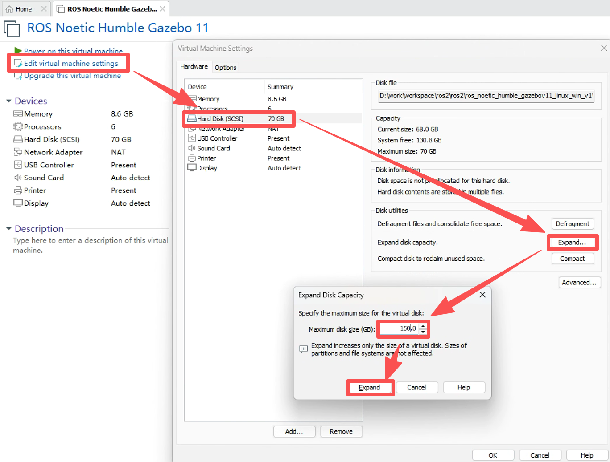
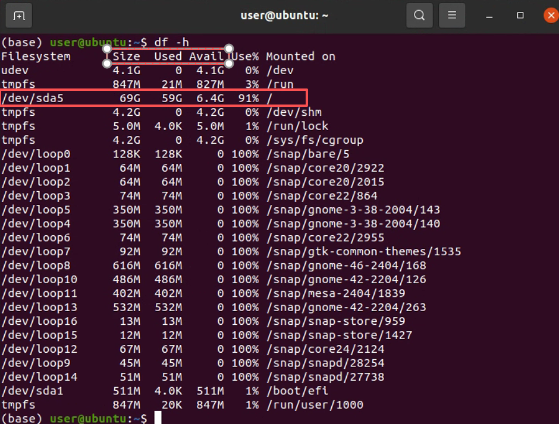
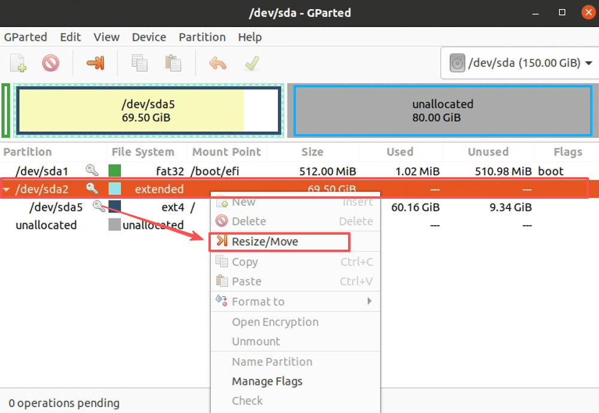
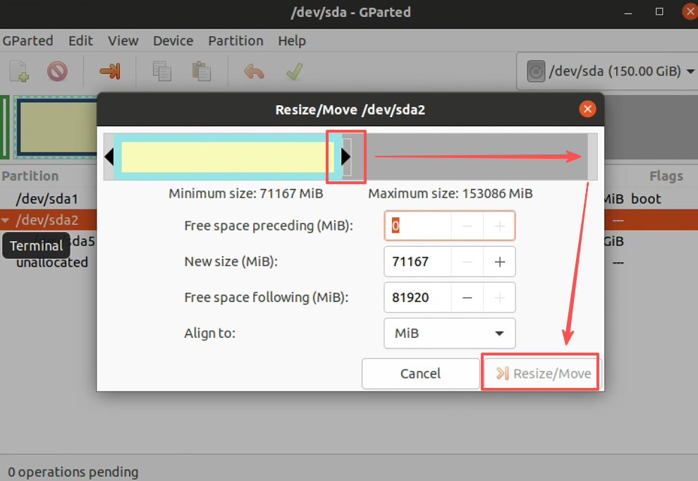
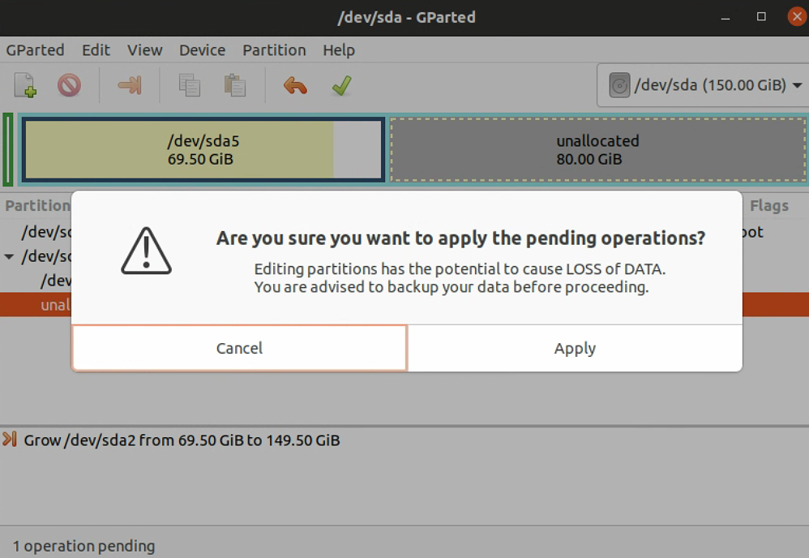
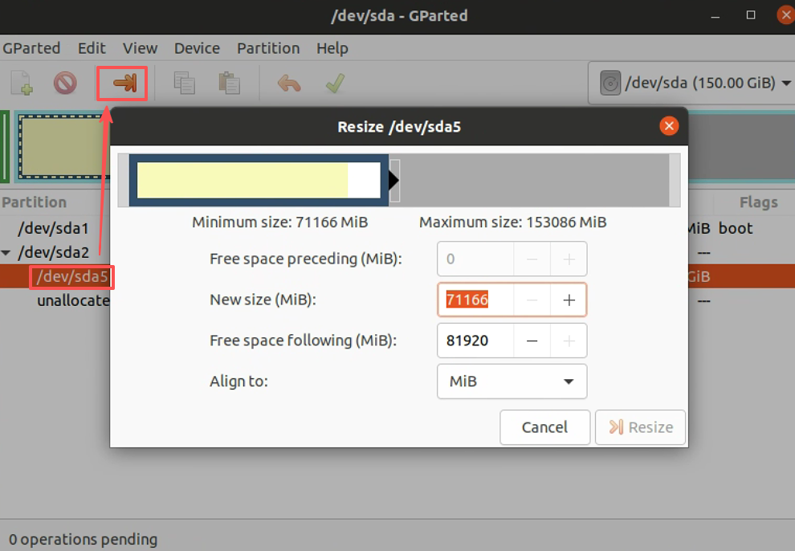
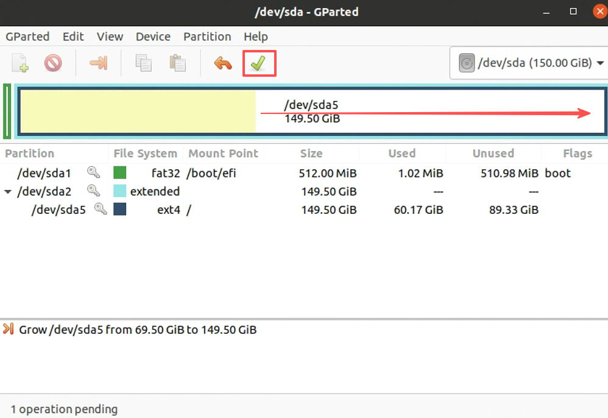
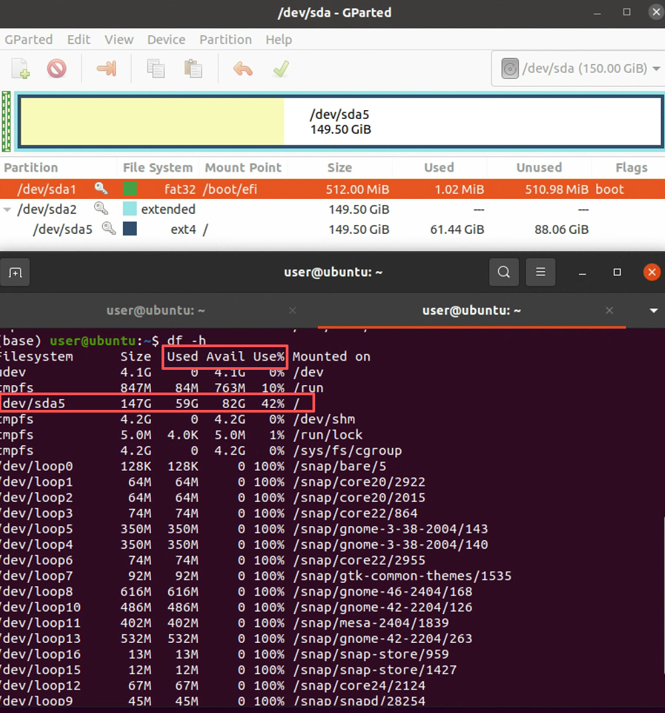

# 给 Ubuntu 虚拟机硬盘扩容

为了解决在使用 Ubuntu 虚拟机时，预先设置的硬盘容量不够用的问题，本文将详细描述解决方案的操作步骤。[虚拟机安装及Ubuntu系统加装](https://openhutb.github.io/ros2/chapter/chap2/)

## 1. 虚拟机设置

如果 Ubuntu 虚拟机处于运行状态，需关机。然后打开“Edit virtual machine settings”，选择“Hard Disk (SCSI)”一栏，然后选择“Expand”选项。接着设置最大磁盘大小（Maximum disk size），这里设置的是扩展到 150GB，如下图所示：




到这一步，扩展虚拟机硬盘容量还没有完成，虚拟机中的系统不会自动扩展新分配的硬盘空闲区。


## 2. 虚拟机扩容

调整分区前，先备份重要文件。下面的 `/dev/sda2` 和 `/dev/sda5` 是截图中的设备名，不同虚拟机的名称和分区布局可能不同，不能直接照着选择。

在 Ubuntu 终端运行：

```shell
lsblk -o NAME,SIZE,FSTYPE,MOUNTPOINTS
df -h /
```

先找挂载点为 `/` 的分区，再结合容量和文件系统类型，在 GParted 中确认同一块磁盘、同一个分区。如果实际布局与截图不同，或使用了 LVM、加密卷，应先查对应的扩容方法，不要直接套用后面的分区顺序。

启动虚拟机中 Ubuntu 系统，使用命令`df -h`查看目前文件系统挂载情况：



命令输出结果可知，根目录总共有 69G，目前已经使用了 59G，还剩下 6.4G。

### 根分区正在使用时

如果 GParted 显示分区带锁，或「Resize/Move」不可用，先查看该分区是否已挂载。正在运行的 Ubuntu 根分区不能像普通数据分区一样直接卸载；能否在线调整还取决于文件系统和操作类型，不能用强制卸载绕过限制。

需要离线调整时，可以按以下顺序操作：

1. 确认重要文件已备份，正常关闭虚拟机。
2. 在虚拟机的光驱设置中挂载 Ubuntu 安装镜像或 GParted Live 镜像，并从镜像启动。使用 Ubuntu 镜像时选择试用环境，不要进入安装或格式化流程。
3. 在试用环境中打开 GParted，按前面记录的磁盘容量、分区和文件系统确认目标。确认待调整分区未挂载；若交换分区正被使用，需要先停止使用该交换分区。
4. 再按后面的截图说明调整分区，并在应用前核对待执行的操作，不应包含格式化或删除原分区。
5. 操作结束后关机，断开启动镜像，再从原虚拟硬盘启动 Ubuntu，用 `lsblk -o NAME,SIZE,FSTYPE,MOUNTPOINTS` 和 `df -h /` 核对根分区容量。

使用 LVM 或加密卷时，请继续按对应方案处理，不要套用截图中的普通分区操作。相关限制见 [GParted 手册：卸载分区](https://gparted.org/display-doc.php?name=help-manual#gparted-unmount-partition)。

### 调整截图中的分区

打开 GParted。示例中新增的未分配磁盘空间约为 80GB。

下面以截图中的分区布局演示调整过程，先选中 `/dev/sda2`，右键选择“Resize/Move”，如下图所示。操作自己的虚拟机时，以前面核对的设备信息为准：



接着用鼠标拖动移动箭头来增加硬盘容量大小，在移动完成后，点击“调整大小（Resize/Move）”，如下图所示：



然后点击下图所示的绿色勾，接着会弹出一个警告框，我们点击“应用（Apply）”即可：



最后选择`/dev/sda5`做同样的操作（最后注意点击绿色勾应用修改），如图所示：





接着 GParted 会自动进行分区大小的调整。扩容完成后，使用`df -h`查看：



从上图可知 /dev/sda5 的总大小变为 147G。至此，扩容 Ubuntu 虚拟机硬盘容量就已全部完成。


## 参考

* [【ubuntu】在虚拟机中如何给ubuntu硬盘扩容](https://zhuanlan.zhihu.com/p/552291400)
* [vmware：ubuntu虚拟机如何扩容？](https://blog.csdn.net/qq_34160841/article/details/113058756)
* [GParted 官方操作手册](https://gparted.org/display-doc.php?name=help-manual)
* [lsblk 命令说明](https://man7.org/linux/man-pages/man8/lsblk.8.html)
