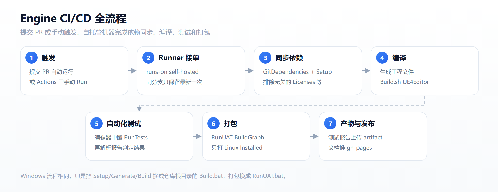

# Engine CI/CD 配置与复现

这份文档记录 OpenHUTB/engine 仓库当前实际在用的 CI/CD 配置。照着做，可以从一台空机器开始，复现出「提 PR 自动编译 → 跑自动化测试 → 打包 Installed Build → 发布 C++ 文档」的完整流程。

> 配置已经通过 PR 合入主仓库：`OpenHUTB/engine#46`。文中命令与工作流文件一一对应，没有写没验证过的步骤。

## 1. 流水线包含什么

| 工作流（文件在 `.github/workflows/` 下） | 触发 | 运行机器 | 做什么 |
|---|---|---|---|
| hutb Linux CI/CD<br>`build_self_hosted_linux.yml` | PR / 手动 | 自托管 Linux | 同步依赖 → 编译 → 自动化测试 → 打 Installed Build |
| hutb Windows CI/CD<br>`build_self_hosted.yml` | PR / 手动 | 自托管 Windows | `Build.bat` → `RunUAT.bat` |
| Engine C++ documentation<br>`doxygen.yml` | push | GitHub 托管 Ubuntu | Doxygen 生成并发布到 gh-pages |

[](img/engine_ci/flow.png)

## 2. 准备一台自托管机器

引擎体积大、编译时间长，GitHub 托管机器扛不住，所以编译和测试都跑在自己的机器上。

### 2.1 机器要求

- Linux：Ubuntu 22.04，建议 8 核、32 GB 内存、200 GB 以上可用磁盘。
- Windows：Windows 10/11，安装 Visual Studio 2019（工作流里用到 `vcvars64.bat`），磁盘同样留足 200 GB。
- 两台机器都要能访问 GitHub 和腾讯工蜂（依赖仓库）。

### 2.2 安装 Linux 编译依赖

```bash
sudo apt-add-repository "deb http://archive.ubuntu.com/ubuntu jammy main universe"
sudo apt-get update
sudo apt-get install build-essential clang lld g++-12 cmake ninja-build libvulkan1 \
  python3 python3-dev python3-pip libpng-dev libtiff5-dev libjpeg-dev tzdata sed curl \
  unzip autoconf libtool rsync libxml2-dev git git-lfs xvfb
sudo update-alternatives --install /usr/bin/g++ g++ /usr/bin/g++-12 180
```

`xvfb` 用来给自动化测试提供虚拟显示，没有图形界面的服务器必须装。

### 2.3 注册 GitHub Actions Runner

在仓库 `Settings → Actions → Runners → New self-hosted runner` 里拿到下载地址和 token，然后在目标机器上执行：

```bash
mkdir actions-runner && cd actions-runner
curl -o actions-runner.tar.gz -L <页面给出的下载地址>
tar xzf actions-runner.tar.gz
./config.sh --url https://github.com/OpenHUTB/engine --token <页面给出的 token>
sudo ./svc.sh install
sudo ./svc.sh start
```

Linux runner 保持默认标签 `self-hosted`、`Linux`、`X64`，与工作流里的 `runs-on: [self-hosted, Linux, X64]` 对应。

Windows runner 工作流里写的是 `runs-on: self-hosted:windows`。注册时给 runner 加上同名标签；如果平台不允许这种标签，就把这一行改成 `runs-on: [self-hosted, Windows, X64]`，两边保持一致即可。

### 2.4 准备私有依赖与 SDK 缓存

- 依赖仓库：`git.code.tencent.com/OpenHUTB/ue4-gitdeps.git`，需要访问令牌。令牌应放在仓库 Secrets 里（例如 `GIT_CODE`），不要写进工作流文件。当前配置为了直观直接写在 `env` 中，建议迁移到 Secrets。
- SDK 缓存：把预下载好的 UE4 SDK 压缩包放到 runner 用户的 `~/ue-cache/` 目录。工作流会把它复制到 `.git/ue4-sdks/`，绕开 `cdn.unrealengine.com` 的单连接限速，避免每次运行都重下几个 GB。

## 3. Linux 工作流逐步说明

### 3.1 触发与并发

```yaml
on:
  pull_request:
  workflow_dispatch:
concurrency:
  group: ${{ github.workflow }}-${{ github.ref }}
  cancel-in-progress: true
```

`workflow_dispatch` 让调试时可以手动跑，不必反复 push；`concurrency` 保证同一个 PR 只保留最新一次运行，否则自托管机器上很容易堆起四五个排队任务。

### 3.2 关键步骤

| 步骤 | 做什么 | 为什么 |
|---|---|---|
| 关闭 git hooks | `git config --local core.hooksPath /dev/null` | 仓库的 post-checkout hook 会调用没有执行权限的 `GitDependencies.sh`，导致 checkout 直接失败 |
| Checkout | `actions/checkout@v5`，`fetch-depth: 0`，`clean: false` | 保留上次下载的依赖，不用每次重来 |
| 恢复 SDK 缓存 | 把 `~/ue-cache/*.tar.gz` 复制到 `.git/ue4-sdks/` | 避开 CDN 限速 |
| 补执行权限 | 对 `*.sh`、`Engine/Binaries`、`Engine/Extras`、第三方 Linux 二进制执行 `chmod +x` | 仓库从 Windows 提交，Linux 下的执行权限丢了 |
| 清理空文件 | 删除 0 字节的 `.ue4dependencies` | 空文件会让 GitDependencies 报 `There is an error in XML document (0, 0)` |
| 同步依赖 | `GitDependencies.sh --dry-run --exclude=Licenses --exclude=registry`，再 `./Setup.sh --exclude=...` | 见下方「为什么要排除」 |
| 生成工程 | `./GenerateProjectFiles.sh` | 生成 Makefile |
| 编译 | `./Engine/Build/BatchFiles/Linux/Build.sh UE4Editor Linux Development` | 对应 Windows 的 MSBuild |
| 自动化测试 | 启动编辑器执行 `Automation RunTests` | 见 3.3 |
| 解析报告 | 读 `Saved/Automation/Reports/index.json` 判定成败 | 编辑器测试失败时进程仍返回 0 |
| 打包 | `RunUAT.sh BuildGraph -script=Engine/Build/InstalledEngineBuild.xml` | 产出 Linux Installed Build |

**为什么要排除 `Licenses` 和 `registry`**（`--exclude` 是官方参数，按目录名匹配）：

1. `Engine/Source/ThirdParty/Licenses/Avid_DNxHD_v2.5.2.37_License.pdf` 在依赖清单里有、仓库里没有，只能从 Epic CDN 拉，匿名请求被拒绝（403）。
2. `Engine/Binaries/ThirdParty/Mono/Linux/etc/mono/registry/last-btime` 会被 Mono 运行时改写，GitDependencies 认为文件被修改后要重新下载，但该对象不在本地缓存。

两者都与编译无关，排除后同步可以稳定通过。同步前先跑一次 `--dry-run`，日志里能看清还有没有别的缺失项。

### 3.3 自动化测试

工作流会在临时目录生成一个只启用测试插件的工程：

```json
{
  "FileVersion": 3,
  "Modules": [],
  "Plugins": [
    { "Name": "EditorTests", "Enabled": true },
    { "Name": "RuntimeTests", "Enabled": true }
  ]
}
```

然后用虚拟显示启动编辑器：

```bash
xvfb-run -a -s "-screen 0 1024x768x24" \
  ./Engine/Binaries/Linux/UE4Editor AutomationTest.uproject \
  -ExecCmds="Automation RunTests $TEST_FILTER" \
  -unattended -nopause -nullrhi -nosound -log \
  -TESTEXIT="Automation Test Queue Empty" \
  -ReportExportPath="$GITHUB_WORKSPACE/Saved/Automation/Reports"
```

`TEST_FILTER` 默认跑 `CString`、`PathViews`、`Algos`、`AsciiSet`、`Timespan`、`DateTime`、`EditConditionParser` 这些轻量测试，手动触发时可以改。

编辑器退出后必须解析 `index.json`：`failed` 或 `notRun` 不为 0、或者 `succeeded` 为 0，都判定失败。报告通过 artifact 上传，失败时直接看里面哪条用例没通过。

实测耗时：Linux 一次完整运行约 50 分钟。

## 4. Windows 工作流

Windows 侧尽量复用仓库自带的脚本：

1. **Checkout 设 `continue-on-error: true`。** post-checkout hook 会同步约 11.6 GB 依赖，同步完成后可能返回非 0，日志里表现为 `git.exe failed with exit code 1`。
2. **加一步 `Verify checkout`。** 检查 `.git` 存在、`git rev-parse --verify HEAD` 能通过，确认工作区可用再继续。
3. `call Build.bat --git-code <token>` 编译。
4. `call RunUAT.bat` 打包。
5. 结束后清理，最后删除 `.git` 目录，避免依赖缓存把磁盘占满。

实测耗时：Windows 一次完整运行约 2 小时，比 Linux 慢很多，所以更要靠 `concurrency` 控制排队。

## 5. C++ 文档工作流

```yaml
- uses: mattnotmitt/doxygen-action@v1.9.5
  with:
    enable-latex: true

- name: Deploy
  if: github.repository == 'OpenHUTB/engine'
  uses: peaceiris/actions-gh-pages@v4
  with:
    github_token: ${{ secrets.GITHUB_TOKEN }}
    publish_dir: ./Doxygen/html/
```

关键在 `if`：fork 仓库里的 `GITHUB_TOKEN` 是只读的，推 `gh-pages` 必然 403。加上仓库判断后，fork 只构建、不发布，失败邮件也就没有了。这个条件加上后，手动触发验证过：构建通过，Deploy 显示 skipped。

## 6. 怎么验证配置可用

1. 打开 `Actions`，选对应工作流，点 `Run workflow`；Linux 可以填 `test_filter`。
2. 跟日志看三个关键节点：checkout 成功、`===== Setup.sh 之后 =====` 能看到 `UnrealBuildTool.exe`、自动化测试输出通过/失败统计。
3. 跑完确认 artifact 里有 `automation-report`，Linux 还要确认 `Make Installed Build Linux` 成功。
4. 失败时先看第一个报红的步骤，不要从后往前猜。

调试期建议只用 `workflow_dispatch` 手动触发，不要在每次 push 时都跑，否则几小时的构建会占满机器。

## 7. 我们踩过的坑

| 现象 | 原因 | 解决 |
|---|---|---|
| 依赖同步打印 SUCCESS 但没下东西 | `Setup.sh --force` 的参数被 GitDependencies 归一化成 `-force`，直接忽略 | 不加 `--force`，直接调 `GitDependencies.sh` 或 `Setup.sh` |
| `There is an error in XML document (0, 0)` | 上次运行留下 0 字节 `.ue4dependencies` | 同步前删除空文件，不要用 `touch` 占位 |
| `Failed to download ... 403` | 依赖清单里的 License PDF 仓库中没有 | `--exclude=Licenses` |
| 每次都重新下载 Mono 文件 | `registry/last-btime` 被运行时改写 | `--exclude=registry` |
| checkout 报 `exit code 1`（Windows） | post-checkout hook 返回值异常 | `continue-on-error` + `Verify checkout` |
| fork 里 Deploy 报 403 | fork 的 token 只读 | `if: github.repository == 'OpenHUTB/engine'` |
| 四五个运行同时排队 | 自托管机器单次构建数小时 | `concurrency` + `cancel-in-progress: true` |

## 8. 复现清单

| 检查项 | 完成标准 |
|---|---|
| Runner 在线 | 仓库 Settings → Actions → Runners 显示 Idle |
| 编译依赖 | `g++-12`、`cmake`、`ninja`、`xvfb-run` 都能直接执行 |
| 私有依赖 | 工作流能 clone `ue4-gitdeps` 并完成 `git lfs pull` |
| SDK 缓存 | `~/ue-cache/` 有压缩包，运行日志能看到复制到 `.git/ue4-sdks` |
| 编译 | 日志出现 `Build.sh UE4Editor Linux Development` 成功 |
| 测试 | `Saved/Automation/Reports/index.json` 中 `failed`、`notRun` 为 0 |
| 打包 | `Make Installed Build Linux` 目标成功 |
| 文档 | push 后 gh-pages 更新，fork 中 Deploy 为 skipped |
