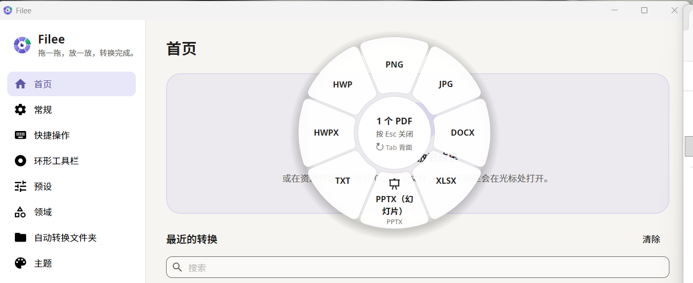

# Filee 文件转换工具

> 假如你已经受够了PDF转word需要vip的日子了，接下来的内容或许会给你一些帮助


> 一个免费开源的本地文件格式转换器。
> 官网：https://filee.sh/zh-cn/
> 仓库：https://github.com/KnifeLemon/Filee
> 许可证：MIT

## filee是什么

Filee 是一款跑在自己电脑上的格式转换工具，转换全程离线，文件不会上传到任何服务器，也不需要注册账号。它内置了 147 种格式的转换能力，电脑里没装 Office、没有 LibreOffice 也能转 Word、Excel、PPT、PDF、图片、电子书、音视频等常见文件。

它的交互方式和传统软件不一样：不用先打开软件界面再导入文件，而是在资源管理器里选中文件，按住一个键拖出去，光标旁边会弹出一个圆环（如下图），上面列着这批文件能转成的目标格式，把文件丢到格式上松手就开始转，完成后新文件直接出现在原文件旁边。



目前版本 v2.4.1，支持：

- Windows 10/11（x64）
- Linux（x64 / ARM64，Ubuntu 22.04 及以上）
- macOS 13 及以上（预览版）

## filee的下载

Windows 有两种安装方式，二选一：

- 命令行安装（最简单）：打开 PowerShell 执行
  ```powershell
  winget install KnifeLemon.Filee
  ```
- 手动下载：去官网或 GitHub Releases 页下载安装包 `Filee-x.x.x-win-Setup.exe`。不想安装的话，下载 `Portable.zip` 便携版，解压后双击 `Filee.exe` 就能用，不写注册表。

Linux 用户从 Releases 页下载对应架构的压缩包；macOS 用户下载预览版 dmg。

## 安装时的选项别一路下一步

Windows 安装过程中会弹出一组可选项，这一屏直接决定以后好不好用，建议这样勾：

- 资源管理器右键菜单：勾上。以后在文件上点右键就能看到“Convert with Filee”，不用拖拽也行。
- 把 filee 命令加入 PATH：勾上。想用命令行批量转换就靠它。
- 登录时启动：可勾。勾了之后后台常驻，随时拖文件都能唤起圆环；在意开机速度就不勾。
- FFmpeg 引擎（约 100 MB）：平时只转文档和图片可以不勾；要转视频、音频格式再勾。这个引擎以后在软件里需要时也能再下载，不是必须现在装。

如果 Windows 弹出 SmartScreen 蓝色警告，点“更多信息”→“仍要运行”即可，安装包用开源代码证书签名过。

## 上手：拖一下就转

最常用的流程就三步：

1. 在资源管理器或桌面上选中一个或多个文件（按住 Ctrl 可以多选）。
2. 按住 `Ctrl` 键不放，把文件往外拖。鼠标旁会弹出格式圆环，圆环上只显示这批文件真正能转成的格式。
3. 移到想要的格式上（比如 DOCX、JPG、WEBP、PDF），松开鼠标。进度环走完后，转换好的文件会出现在原文件同一个文件夹里，文件名和原文件同名，只是后缀变了。

几个新手容易不知道的小操作：

- 圆环打开后，按 `Tab` 键或者滚动鼠标滚轮，圆环会翻到背面，背面是工具类操作：裁剪图片、旋转、翻转、灰度、去背景、把多个文件合并成一个 PDF、打包成一个 ZIP。
- 不想拖拽的话，直接在文件上点右键，选“Convert with Filee”，在菜单里选目标格式。
- 纯键盘操作：在 Filee 主窗口选中文件按 `Enter`，用方向键选格式，再按 `Enter` 开始转换。
- 拖拽时按住的修饰键（默认 Ctrl）可以在设置里改成别的键。

## 一次转很多文件

选中多个文件一起拖就行，Filee 会并行处理。其中某个文件失败不影响其他文件继续转，结束后会告诉你哪几个成功、哪几个失败。

多步转换它会自己找路。比如一个 HWPX 想转成 DOCX，它会自动规划中间路线，不用你手动转两次。

## 命令行用法

安装时勾了“加入 PATH”后，打开终端就能用 `filee` 命令。常用形式：

```bash
# 单文件转换
filee convert photo.heic --to jpg

# 批量通配符，指定质量和输出目录
filee convert *.png --to webp --quality 80 -o converted

# 递归转换整个文件夹，使用预设，输出 JSON（方便接脚本）
filee convert D:\Scans --recursive --preset to-pdf --json

# 查看某格式支持转成什么
filee formats heic

# 查看已有预设
filee presets
```

脚本调用时靠退出码判断结果：0 全部成功，1 部分失败，2 参数错误，3 没有可转换的文件。`--json` 参数会把结果以 JSON 打印出来，适合写进批处理或定时任务。

## 监视文件夹：当个自动收件箱

如果你有一堆东西会不断落进同一个文件夹（比如下载目录、手机照片同步目录、扫描仪输出目录），可以把它设成“收件箱”：

```bash
filee watch D:\Inbox --to pdf --move-originals
```

执行后它会盯着这个文件夹，一旦有新文件复制进来，就自动转成指定格式存到 `converted` 子目录，`--move-originals` 会把原文件挪走，避免重复转换。按 `Ctrl+C` 停止监视。

这个功能也可以在软件主界面的“自动转换文件夹”页面里图形化配置，可以加过滤规则（只转 `*.heic`、只转 `scan_*` 开头的文件），还能自定义转换后的文件命名规则。

## 关于 PDF 的说明

Filee 能处理 PDF，但要分清两件事：

- **PDF 互转和 PDF 工具**：拖一个 PDF 到圆环上，它会列出该 PDF 支持的操作和目标格式（转图片、合并多个 PDF、转成文档类格式等）。如果圆环上出现 DOCX，就可以直接拖过去转。
- **扫描版 PDF**：如果一份 PDF 本身就是扫描出来的图片、里面没有文字层，那么它本质是图片，转出来的 Word 也只是把图片嵌进去，不能直接编辑文字。这类文件需要先做 OCR 文字识别，属于另一类工具的活，不要指望任何“转换器”能把扫描件直接变成可编辑文档。
- **加密 PDF**：带打开密码或权限限制的 PDF 先解密再拖。

## 什么情况需要额外下载引擎

大部分常见格式（DOCX、XLSX、PPTX、HWP、图片、PDF 等）内置引擎直接转，不装任何东西。只有少数情况软件会提示你按需下载一个引擎：

- 视频、音频转码 → FFmpeg（约 100 MB）
- 老格式（DOC、PPT、ODT、RTF）→ LibreOffice
- 少见电子书格式 → Calibre
- 高级 PDF 处理 → Ghostscript
- Markdown 类文档排版 → Pandoc

软件会在你第一次用到对应功能时提示下载，不强制。如果电脑里已经装了 FFmpeg 或 Calibre，Filee 会直接复用，不重复下载。

## 常见问题

**转换后的文件在哪？** 默认和原文件放同一个文件夹，文件名相同、后缀换成目标格式。命令行里用 `-o 路径` 可以改输出目录。

**转换出来排版乱了？** PDF 转 Word 这类操作本质是“从固定版面重建可编辑文档”，多栏排版、复杂图文混排本来就难完美还原，转完在 Word 里手动调一下是正常的。

**软件提示某个格式转不了？** 拖文件时圆环上列出的就是当前能用的全部目标格式；列表里没有的，说明要么需要先装对应可选引擎，要么这个方向本身不支持。用 `filee formats <格式名>` 在命令行里可以查得更全。

**Linux 下拖拽没反应？** 需要 X11 环境；KDE Plasma 的 Wayland 下拖拽是实验性功能，换 X11 会话或者用右键菜单/命令行。

注：本文只志在于大家一起分享并做出安装和使用此工具的教程。更多详细信息可以查阅https://github.com/KnifeLemon/Filee。