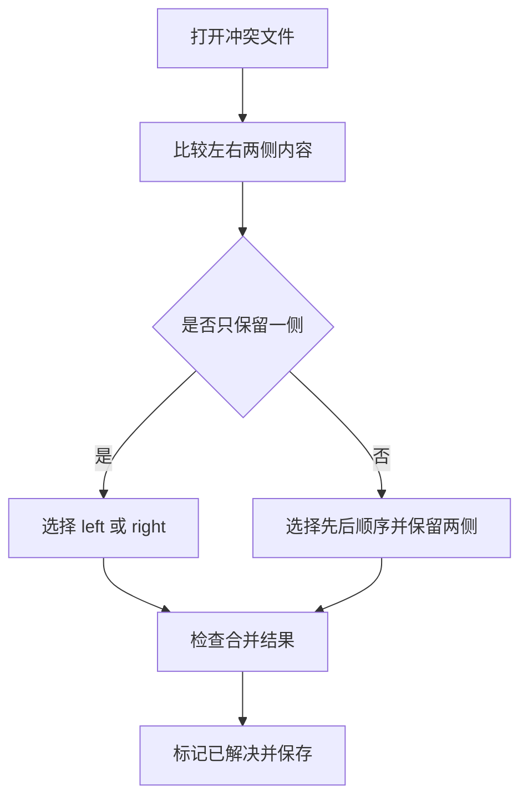

# 使用 TortoiseGit 解决冲突

在发生冲突的文件中，冲突区域会有标记，比如：
```shell
<<<<<<< yours
    你当前工作区的代码
=======
    合并过来的代码
>>>>>>> their
```

可以使用任何编辑器手动解决冲突，也可以通过 TortoiseGit 提供的菜单解决冲突：选中冲突文件，在右键菜单中选择`TortoiseGit` → `Edit Conflicts` ，启动外部合并工具/冲突编辑器手动解决冲突。


左边文件为:远程仓库的文件，右边为本地文件(也就是你当前修改的文件)；
下边的文件是你合并操作后的文件。

在合并处,鼠标右击:

1. Use text block from left:使用远程库的代码
2. Use text block from right:使用本地的代码
3. Use text block from right before left:
远程库和本地文件的代码都保留,且本地库的代码放在上面,远程库的代码放在下面

    Use text block from left before right:
远程库和本地文件的代码都保留,且本地库的代码放在下面,远程库的代码放在上面

最后,点击Mark as resolved 和Save按钮即可(如果冲突比较多,就点击Next difference一个个排查解决冲突即可)。

## 参考


* [使用小乌龟TortoiseGit快速解决代码冲突问题](https://blog.csdn.net/qq_34550459/article/details/108438031)
* [TortoiseGit 入门指南06：解决冲突](https://blog.csdn.net/zhzht19861011/article/details/131715372)


## 选择保留内容的顺序



不要只根据 left、right 的名称判断内容，应先查看当前合并方向和实际代码。保留两侧时，还要检查语句顺序、重复导入和重复配置。

## 完成后的核对

1. 搜索文件中是否还存在 `<<<<<<<`、`=======`、`>>>>>>>` 标记。
2. 2. 查看最终差异，确认没有误删相邻内容。
   3. 3. 运行与该文件有关的最小检查。
      4. 4. 在 TortoiseGit 中标记已解决，完成提交后再推送。
        
         5. 上方的 TortoiseGit 截图可用于对应按钮位置，流程图用于判断每一步应做什么。
