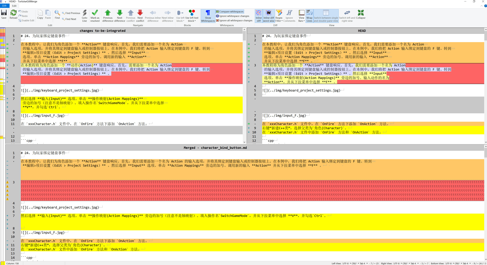

# 使用 TortoiseGit 解决冲突

在发生冲突的文件中，冲突区域会有标记，比如：
```shell
<<<<<<< yours
    你当前工作区的代码
=======
    合并过来的代码
>>>>>>> their
```

可以使用任何编辑器手动解决冲突，也可以通过 TortoiseGit 提供的菜单解决冲突：选中冲突文件，在右键菜单中选择`TortoiseGit` → `Edit Conflicts` ，启动外部合并工具/冲突编辑器手动解决冲突。





图中的左右窗口用于比较两个版本，下方窗口显示合并结果。操作前先查看窗口标题中的文件名和版本，确认哪边是当前版本、哪边是要合入的版本；要合入的内容也可能来自另一个本地分支，不能只按“远程”和“本地”判断。

在合并处,鼠标右击:

1. `Use text block from left`：保留左侧选中的内容。
2. `Use text block from right`：保留右侧选中的内容。
3. `Use text block from right before left`：两侧内容都保留，右侧内容放在前面。
4. `Use text block from left before right`：两侧内容都保留，左侧内容放在前面。

## 保存后还需要做什么

1. 使用 `Next difference` 逐处检查，确认最终内容正确。两侧都保留时，也要检查是否出现重复段落或重复代码。
2. 点击 `Save` 保存合并结果，再选择 `Mark as resolved`，或回到文件的右键菜单选择 `TortoiseGit → Resolved`。
3. 打开文件检查冲突位置，确认 `<<<<<<<`、`=======`、`>>>>>>>` 等冲突标记已经处理完。对于教程里原本就有的标记示例，应保留其内容。
4. 检查修改后的文档页面或运行相关程序，再完成本次操作：普通合并需要提交合并结果；如果冲突出现在 Cherry-pick 或 Rebase 过程中，应回到对应窗口继续，不要另开普通提交窗口。
5. 查看提交记录，确认操作完成后推送当前分支，远程 PR 才能收到这次修改。

`Mark as resolved` 只是告诉 Git 这个文件已处理，不会替你选择正确内容，也不等于已经提交或推送。

## 参考

- [TortoiseGit：解决冲突](https://tortoisegit.org/docs/tortoisegit/tgit-dug-conflicts.html)

* [使用小乌龟TortoiseGit快速解决代码冲突问题](https://blog.csdn.net/qq_34550459/article/details/108438031)
* [TortoiseGit 入门指南06：解决冲突](https://blog.csdn.net/zhzht19861011/article/details/131715372)

