# 远程办公解决方案：tailscale（免费）+rustdesk（开源）

## 1. 把多台机器放进同一个虚拟局域网

* [注册tailscale](https://login.tailscale.com/start)并在需要远程登录的机器上下载对应操作系统版本的[tailscale](https://tailscale.com/download/windows)进行安装。

 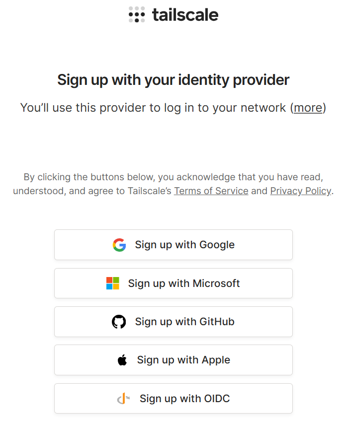

* 将本机加入到虚拟局域网中

 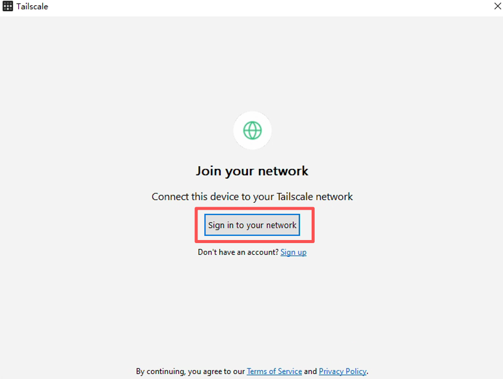

 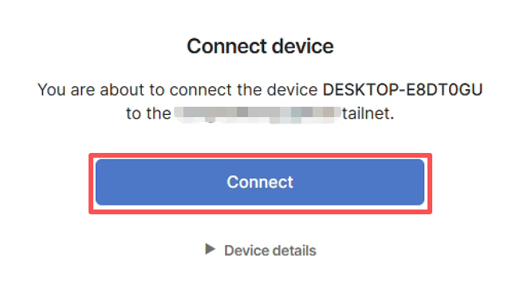

* 将设备添加到同一网络中（添加后就可以在[tailscale后台](https://console.tailscale.com/admin/machines)进行管理。
可以将key设置成永久，防止过段时间需要重新登录）
 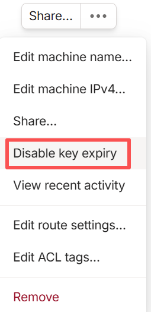

> 启动软件后会点击`sign in to your network`


> 以 github 授权使用为例
 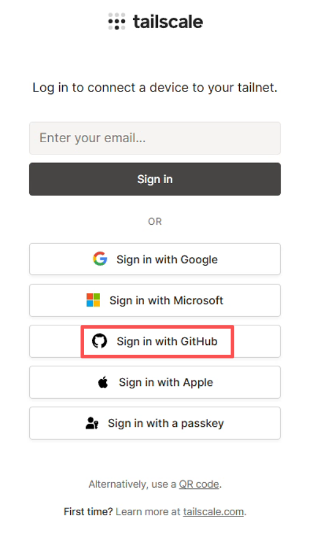
 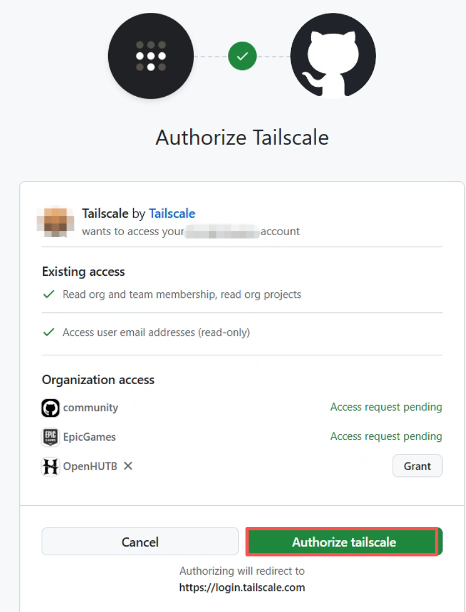

> 提示登录成功后，点击`visit the console`访问控制台，就可以看到已加入虚拟局域网的设备列表
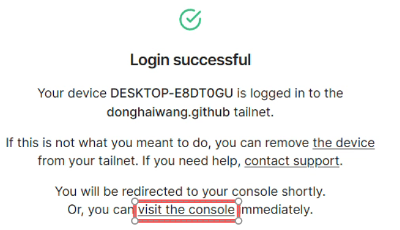


## 2. RustDesk配置与连接

* [下载](https://github.com/rustdesk/rustdesk/releases)并安装RustDesk客户端。

* 控制端/被控端：打开RustDesk，设置->解锁安全设置->勾选“允许IP直接访问”

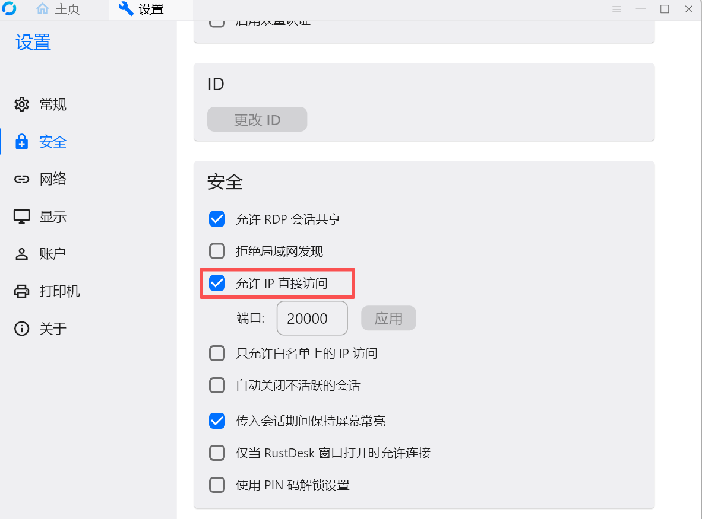

输入被控端的 IP 地址即可远程登录（注意这里是 Tailscale IP，不是台式机的IP ）。

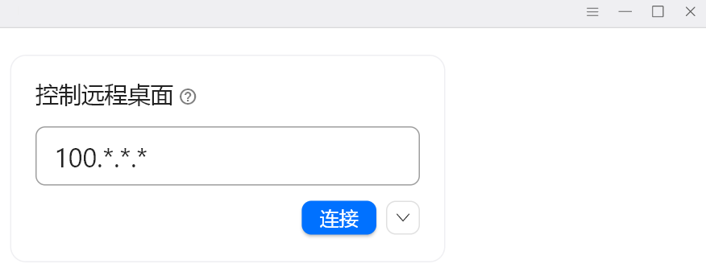

!!! 问题
    如果连接时报错：`连接错误 Failed to connect to 100.*.*.*:21118:请稍后再试`，确认被控端下面是否有“服务未运行”的提示，如果有请点击“启动服务”，然后再次连接即可。额外排查：确认被控端防火墙没有拦截 TCP 21118 端口。


## 附：Windows远程登录

先确认被控机的 Windows 版本：打开“设置 → 系统 → 系统信息”，查看 Windows 版本。Windows 专业版、企业版和教育版可以接受内置远程桌面连接；家庭版可以连接其他电脑，但不能作为这种连接的被控端。家庭版被控机可使用前面的 RustDesk 方式。

在支持的被控机上，打开“设置 → 系统 → 远程桌面”并启用连接。确认两台设备都已接入 Tailscale，且被控机保持开机、联网，没有进入睡眠状态。

 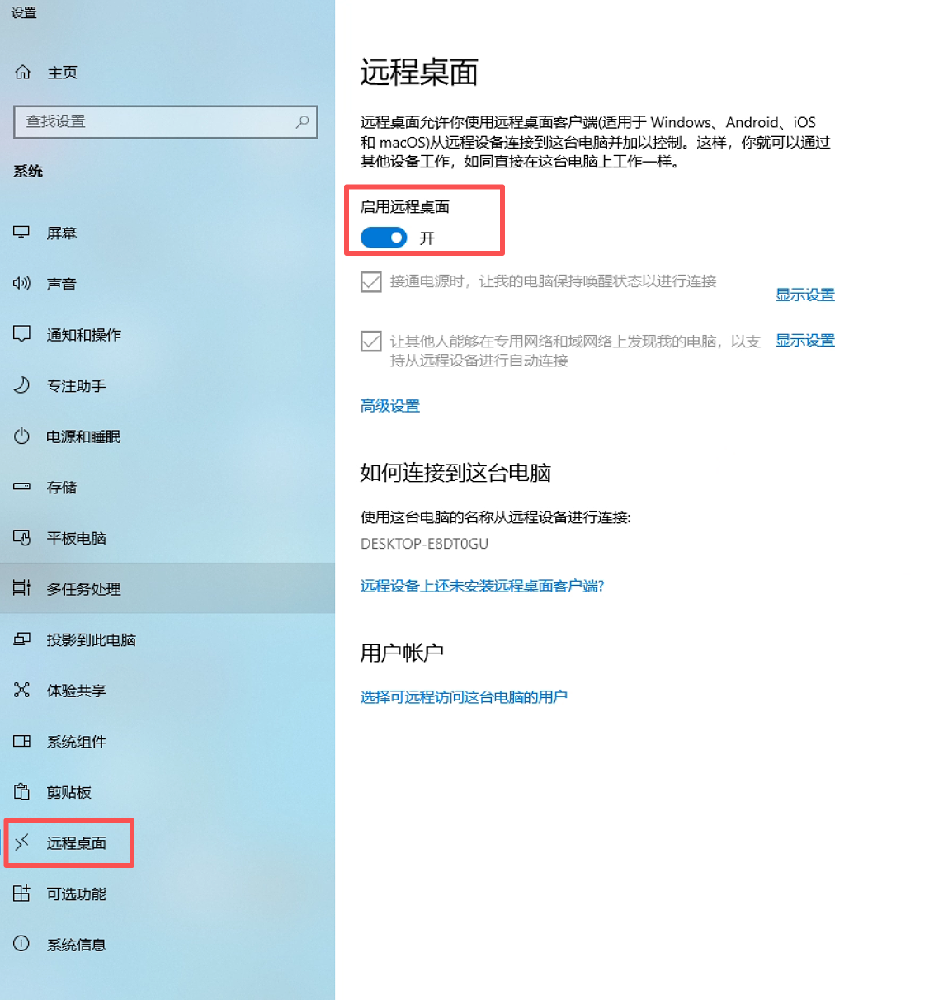


在本地电脑打开`远程桌面连接`，输入被控机的 Tailscale IP 地址，再使用被控机上有远程登录权限的 Windows 账户和密码登录。这里使用账户密码，不是平时解锁电脑时输入的 Windows Hello PIN。图中的 `*` 需要替换为实际 IP 地址。
 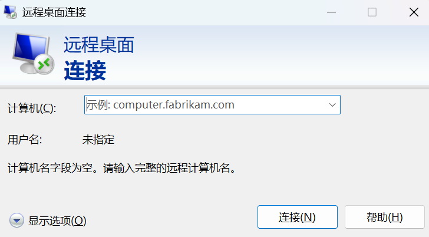


!!! 注意
    如果使用 windows 这一步登录成功，前面第二步的“RustDesk配置与连接”就不再需要。如果是 Ubuntu、Mac、Android、iOS等其他平台，请查第二步的“RustDesk配置与连接”。


## 高级操作

### 邀请其他成员进入虚拟局域网

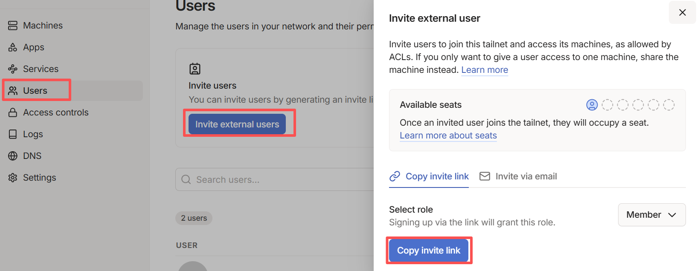


服务器所在的是**个人 tailnet**，不能直接"加成员"，正规做法是**节点共享**。

**使用tailscale共享具体步骤**

**共享方操作**

1. 打开 [链接](https://login.tailscale.com/admin/machines)并在需要远程登录的机器上下载对应操作系统版本的[tailscale](https://tailscale.com/download/windows)进行安装。
2. 找到所需要的机器 **机器名（服务器ip地址）**，点右侧 **⋯（三个点）→ Share machine（共享设备）**
3. 在tailscale的设置页面选择Reusable link并点击Copy share link
  
   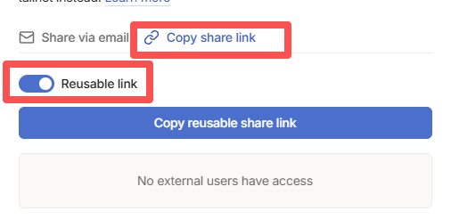

**接收方操作**

1. 使用github账号登录并打开[链接](https://login.tailscale.com/admin/invitations)（或注册邮箱里的邀请邮件），**接受**这台共享设备
2. 接受后在 admin/machines 里即可看到该设备，用  服务器ip地址  访问
   


## 附：通过 SSH 登录服务器

前面的 RustDesk 和 Windows 远程桌面适合需要图形界面的场景。如果被控端是 Linux（例如 Ubuntu），并且只需要命令行，直接用 SSH 登录会更轻量。这一节的网络通道仍然由 Tailscale 提供，但认证交给系统自带的 SSH 服务，可以绕开 Tailscale 自带 SSH 的账号限制。

### 常见报错：tailnet policy does not permit you to SSH to this node

服务器开启 Tailscale 自带的 SSH 功能后，客户端执行 `ssh` 时可能报错：

```text
tailnet policy does not permit you to SSH to this node
```

原因是 Tailscale SSH 有一条强制规则：用户只能 SSH 到属于自己账号的设备。当服务器是别人共享给你的设备时，它的所有者不是你的账号，所以无论怎样修改 [ACL 策略](https://login.tailscale.com/admin/acls) 都不会被授权。这种情况下要改的不是 ACL，而是认证方式。

### 解决方法（在服务器上执行）

1. 关闭 Tailscale 自带的 SSH 认证拦截：

    ```bash
    sudo tailscale set --ssh=false
    ```

2. 确认系统原生的 SSH 服务已安装并启用：

    ```bash
    sudo systemctl enable ssh
    sudo systemctl restart ssh
    ```

!!! 提示
    如果执行时报找不到 `ssh` 服务，说明服务器还没有安装 OpenSSH 服务端，先执行 `sudo apt install openssh-server`。

### 连接方式

在同样加入了 Tailscale 的客户端上执行：

```bash
ssh <服务器用户名>@100.x.x.x
```

其中 `100.x.x.x` 是服务器的 Tailscale IP，可以在 [Tailscale 后台](https://console.tailscale.com/admin/machines) 的设备列表里查看。输入服务器上该账号的系统密码即可登录。

### 原理

* **Tailscale 只负责网络层**：让你的电脑和服务器处在同一个虚拟局域网中，通过 Tailscale IP 互相访问。
* **SSH 认证走系统原生体系**：直接使用服务器本地的账号和密码验证，不再经过 Tailscale SSH 的 ACL 策略。

!!! 注意
    关闭 Tailscale SSH 只影响“通过 Tailscale 使用 SSH”这一种方式，RustDesk、远程桌面等其他功能不受影响。如果服务器开启了防火墙，还需要确认放行 TCP 22 端口。

## 参考
* [tailscale 源代码仓库](https://github.com/tailscale/tailscale) - [tailscale 开源介绍](https://tailscale.com/opensource)
* [rustdesk 源代码仓库](https://github.com/rustdesk/rustdesk)
* [微软：启用远程桌面的条件与设置](https://learn.microsoft.com/zh-cn/windows-server/remote/remote-desktop-services/remotepc/remote-desktop-allow-access)
* [使用 Tailscale 实现内网穿透+RDP远程控制](https://www.cnblogs.com/lefour/p/18866579)


