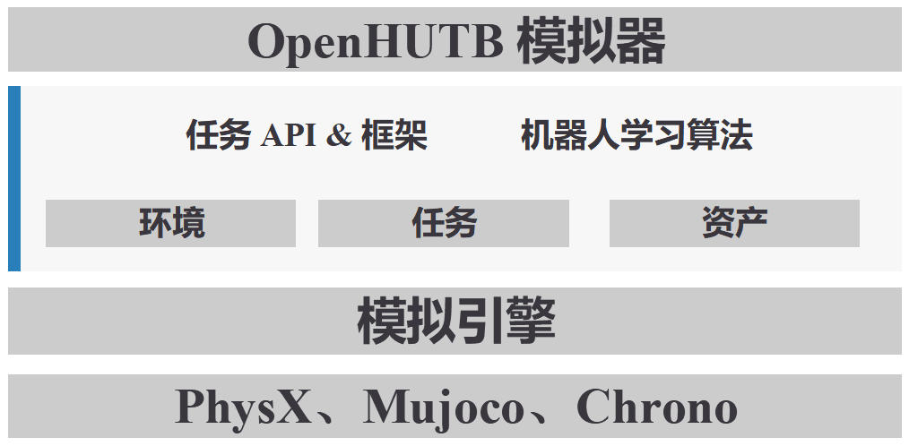

# OpenHUTB 模拟器简介

## OpenHUTB 的工作原理

[**OpenHUTB**](https://github.com/OpenHUTB/hutb) 的模块化架构，使其非常适合用于构建覆盖多种机体形态的机器人策略，包括人形机器人、肌肉骨骼人、地面载具、空域载具、水域载具。

它还提供了一个完整的机器人学习框架，涵盖从环境搭建到策略训练的全流程，同时支持模仿学习和强化学习方法。此外，你可以通过集成多种物理引擎（如 NVIDIA® PhysX®、MuJoCo、Chrono）进一步定制和扩展 OpenHUTB 的能力。

