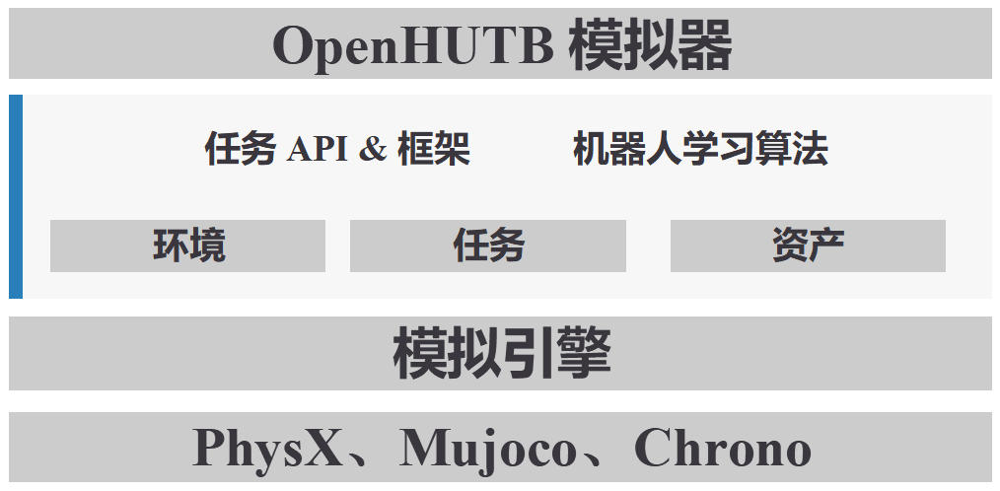

# OpenHUTB 模拟器简介

## OpenHUTB 的工作原理

[**OpenHUTB**](https://github.com/OpenHUTB/hutb) 的模块化架构，可用于构建覆盖多种机体形态的机器人策略，包括人形机器人、肌肉骨骼人、地面载具、空域载具和水域载具。

机器人学习功能由模拟器和相关研究项目共同构成，包含环境搭建、策略训练，以及模仿学习和强化学习方法。模拟环境也可结合 NVIDIA® PhysX®、MuJoCo、Chrono 等物理引擎进行扩展；具体能力和依赖以各项目说明为准。

## 相关项目入口

- [hutb 人车模拟器](https://github.com/OpenHUTB/hutb)：模拟器仓库和 Python API。
- [doc 人车文档](https://github.com/OpenHUTB/doc)：安装、Python API、场景制作和开发资料。
- [neuro 神经原理](https://github.com/OpenHUTB/neuro)：感知与神经网络相关研究和实验。
- [PFC 规划](https://github.com/OpenHUTB/PFC)：规划相关研究内容。
- [move 控制原理](https://github.com/OpenHUTB/move)：运动控制与生物力学相关内容。
