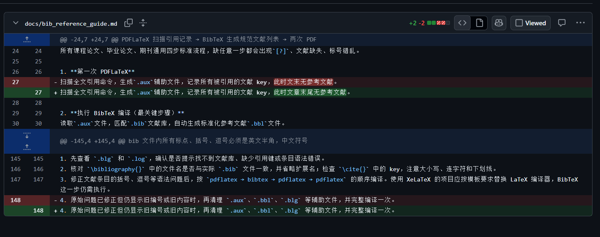
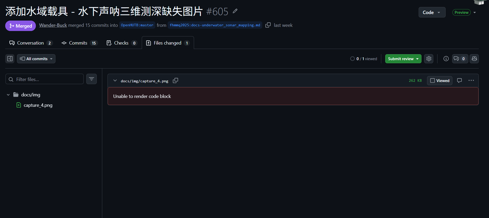
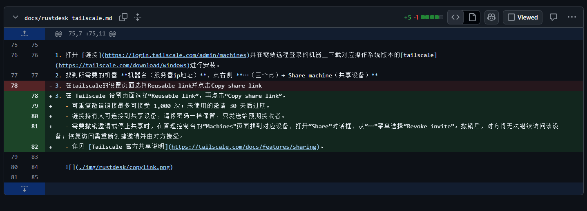
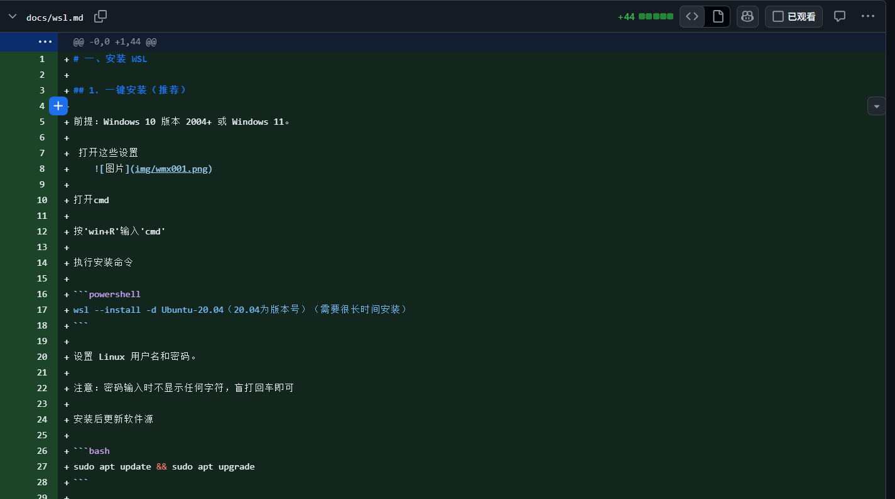
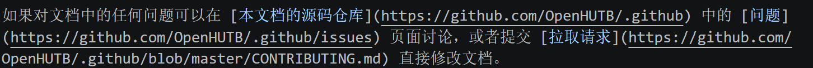
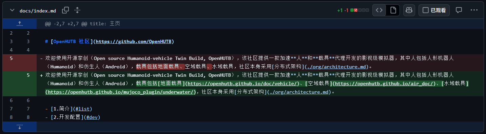

# 文档修改指南   
（创建拉取请求之后一定要在下方的评论区@有权限的人审核）

## 1. 下载 Git
下载后会得到一个 `.exe` 文件，双击运行安装：
[https://git-scm.com/install/windows](https://git-scm.com/install/windows)

## 2. 下载 Visual Studio Code
下载后会得到一个 `.exe` 文件，双击运行安装：    
(打开网站首页第一个是Visual Studio 2026,第二个才是所需的Visual Studio Code)
[https://visualstudio.microsoft.com/zh-hans/downloads/](https://visualstudio.microsoft.com/zh-hans/downloads/)

## 3. 克隆仓库
> **注意**：该命令中的 `{用户名}` 请替换为自己的用户名。

```bash
git clone https://github.com/{用户名}/.github.git
```

克隆完成后进入仓库目录：

```bash
cd .github
```

## 4. 介绍 .github 文件结构

- **`docs`**：主要修改的地方。
- **`docs/img`**：存放图片的地方。图片必须重命名，不可以像 `"屏幕截图 2026-11-04 011000.png"` 之类的默认名称。
- **`docs/src`**：存放代码的地方。
- **`docs/paper`**：放论文的地方。
- **`docs` 下的 `.md` 文件**：修改的具体地址（`.md` 文件也是 Markdown 源文件）。

## 5. 快速修改方向（红色部分是原句，绿色部分是改句）

1. 将一些不重要的句子换成另一些不重要的句子。


2. 跑一些代码（文档之类的）之后补充细节，以及该文档与你跑过程一切不一样的地方。


3. 原创一些文档但故意留一些错误（句子，代码错误，符号，固定路径）交给其他人补全。

4. 修改一些表达不到位的句子。

5. 加一些跳转链接.


## 6. 如何修改

1. 在文档网站找到你要修改的地方。(你现在在看的就是文档网站)
2. 在克隆仓库的 `..\.github\mkdocs.yml` 找到你在文档网站需要修改的地方所对应的 `.md` 文件。
3. 打开对应的 `.md` 文件，在 Visual Studio Code 中修改。
4. 保存修改（`Ctrl+S`）。
5. 如果是添加文档，要在 `mkdocs.yml` 里对应的地方加入链接，或在其他 `.md` 文件加入跳转链接。

**在 `mkdocs.yml` 里对应的地方加入链接的格式：**

```yaml
- 标题: '.md文件路径(在docs之后的路径，docs不用写)'
```

例如：

```yaml
- 模拟器演示：涉水效果: 'introduction.md'
- 使用 VScode 推送代码: 'dev/vscode_push.md'
```

**在其他 `.md` 文件加入跳转链接格式：**

```markdown
[标题](.md文件路径)
```

（如果两个 `.md` 文件在同一个目录下，括号里直接写该文件名即可）
例如：

```markdown
[HoloOcean Windows 搭建教程](HoloOcean-Windows-Setup.md)
```

## 7. 预览成果

1. 下载 MkDocs（在命令行中运行以下命令下载）：
   ```bash
   pip install mkdocs mkdocs-material mkdocs-mermaid2-plugin
   ```
   *（如果出现报错，可以将错误信息发给 AI 解决）*

2. 在终端 `cd` 到你的 `.github` 文件夹路径下（例如：`cd 你的路径/.github`），然后运行预览指令：
   ```bash
   mkdocs serve
   ```

3. 找到终端里输出的类似于 `http://127.0.0.1:8000/` 的网址，复制到浏览器中打开，预览你的修改成果。（检查界面是否出错、图片是否正常显示、跳转链接是否失效）。

## 8. 提交

[提交流程](CONTRIBUTING.md)