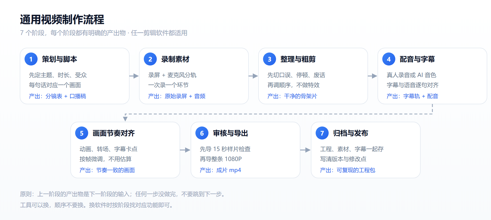
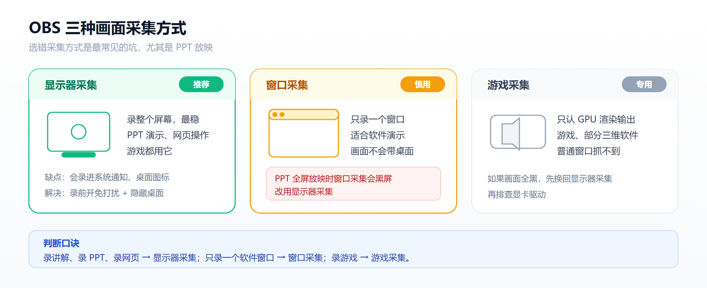
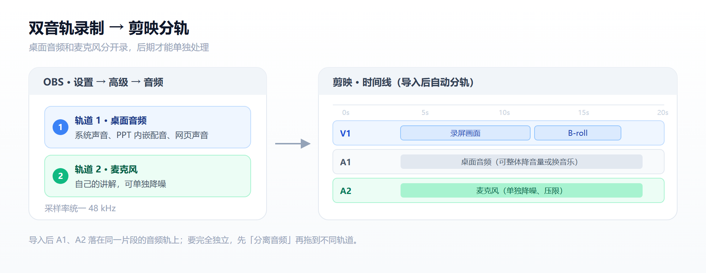
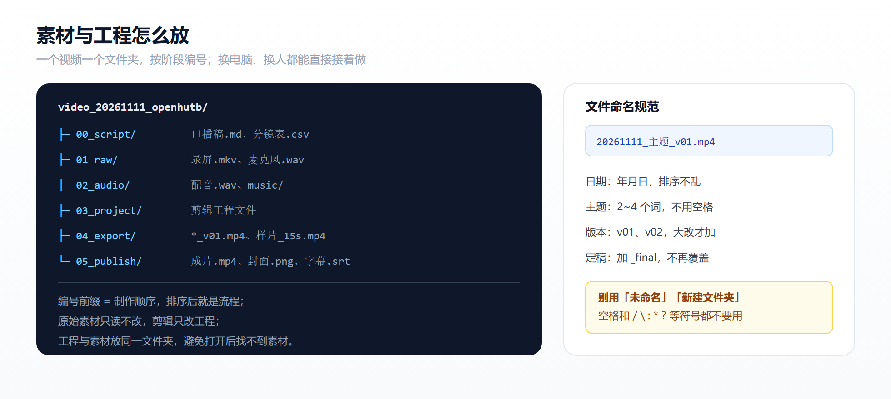
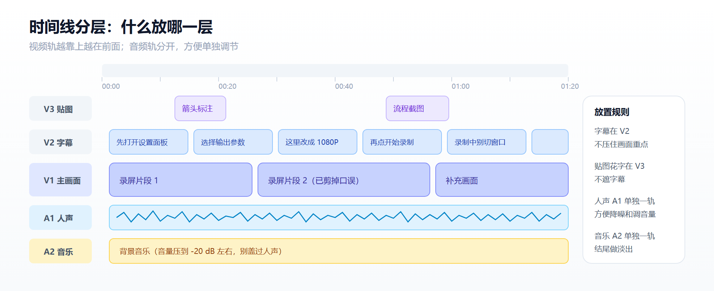
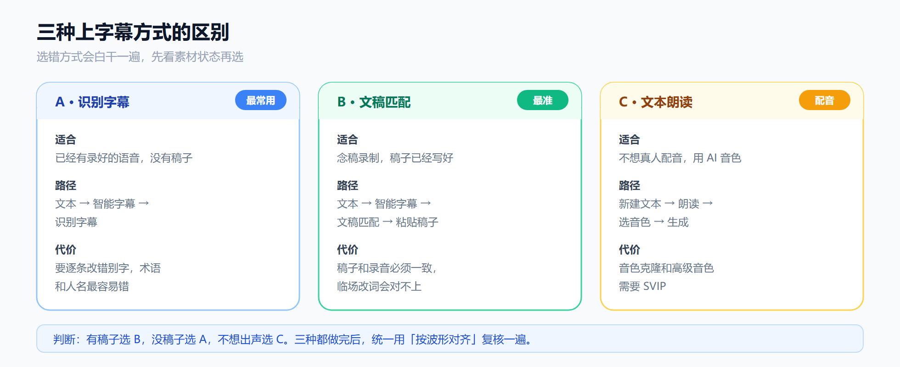
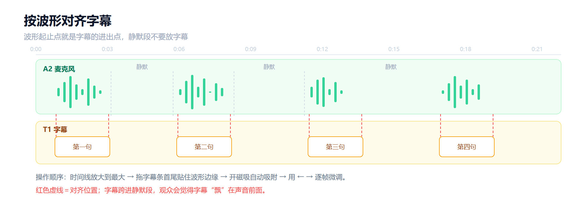
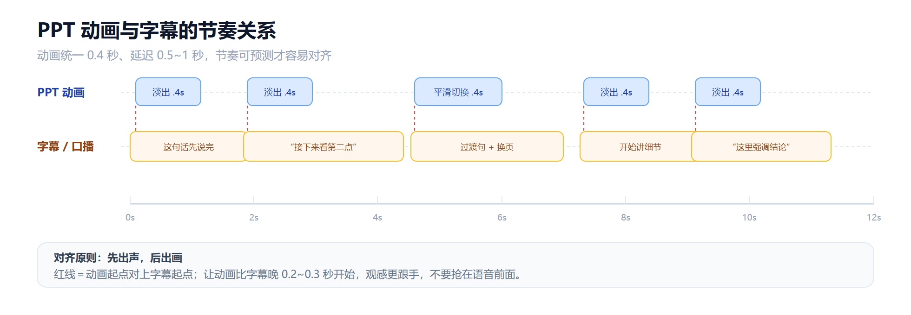
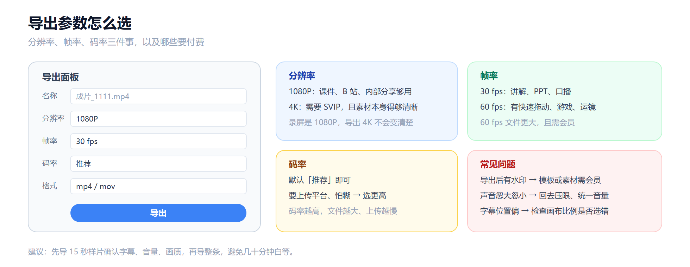

# 视频制作流程

社区的项目演示、功能讲解、教学片段，都可以按这套流程制作。流程本身与软件无关：换成别的剪辑工具，阶段顺序和每一步的检查点不变。文中以 **OBS Studio + 剪映专业版** 为例，给出可以直接照抄的参数；用其他工具时，按阶段找对应功能即可。

[](img/video/pipeline.png)

> 文中示意图都可以点击查看大图。

## 1. 先定成品标准

动手前先把标准写下来，后面每一步都对着它检查。

| 项目 | 建议值 | 说明 |
|---|---|---|
| 画布 | 1920×1080（16:9） | 竖屏短视频改用 1080×1920 |
| 帧率 | 30 fps | 有快速拖动、游戏画面时用 60 fps |
| 音频 | 48 kHz，人声单独一轨 | 全程一致，不要中途改采样率 |
| 响度 | 整体 -16~-14 LUFS | 人声清楚，音乐不盖过讲解 |
| 字幕 | 单行 ≤15 字，每条 ≥1 秒 | 最多两行，放在画面下方安全区 |
| 时长 | 3~8 分钟 | 超过 10 分钟建议拆成系列 |
| 交付物 | mp4 + 工程文件 + 字幕 + 封面 | 工程能重新打开，才算可复现 |

## 2. 阶段一：策划与脚本

产出：`00_script/` 下的口播稿和分镜表。

1. **一句话定主题。** 写清"看完这个视频，观众能学会什么"，写不出来就说明选题太大。
2. **写口播稿。** 用口语，不用书面语；一句话只说一件事，单句控制在 25 字以内；术语第一次出现时顺带解释。
3. **估时长。** 中文口播约 200~250 字/分钟，按字数先估，再实际读一遍计时。
4. **做分镜表。** 四列就够：镜头号、画面内容、对应口播、预计时长。
5. **超时就删稿。** 不要靠后期变速硬压，变速会让讲解听起来不自然。

!!! tip "写稿小技巧"
    稿子里的每个操作步骤，都要能在画面上看见。只靠嘴说、画面没变化的内容，观众很难记住。

## 3. 阶段二：录制素材

产出：`01_raw/` 下的录屏和音频。

### 3.1 选对画面采集方式

[](img/video/obs_capture.png)

在 OBS 的「来源」面板点 `+` 添加：

| 录制对象 | 采集方式 |
|---|---|
| PPT、网页、软件操作 | 显示器采集（最稳） |
| 只录某一个软件窗口 | 窗口采集（PPT 放映会黑屏，不要用） |
| 三维场景、游戏 | 游戏采集 |

### 3.2 输出与音频参数

「设置 → 输出 → 录像」：格式选 `mkv`（崩溃不丢文件，录完用「文件 → 重新封装录像」转 mp4），编码器用硬件编码（NVENC / QSV / AMF），码率控制 `CQP 20~23`，分辨率与屏幕一致，帧率 30 fps。

[](img/video/obs_tracks.png)

「设置 → 音频」把采样率统一为 `48 kHz`；在混音器点齿轮打开「高级音频属性」，把桌面音频勾到轨道 1、麦克风勾到轨道 2。分开录，后期才能单独降噪、单独调音量、单独换配乐。

### 3.3 录音要点

1. 关空调、风扇，手机开飞行模式，关掉微信和邮件通知。
2. 用外接麦克风，离嘴 15~20 cm，略微偏一点防喷麦。
3. 按段落录，说错了停两秒重说这一句，后期好切。
4. 每段开头空一秒再开口，留出剪辑余量。

### 3.4 目录与命名

[](img/video/project_layout.png)

一个视频一个文件夹，编号前缀就是制作顺序：

| 目录 | 放什么 |
|---|---|
| `00_script/` | 口播稿、分镜表 |
| `01_raw/` | 原始录屏、原始录音（只读，不覆盖） |
| `02_audio/` | 配音、背景音乐、音效 |
| `03_project/` | 剪辑工程文件 |
| `04_export/` | 各版本成片、样片 |
| `05_publish/` | 最终成片、封面、字幕文件 |

文件统一命名为 `日期_主题_版本`，例如 `20261111_openhutb_v01.mp4`；定稿加 `_final` 后不再覆盖。

!!! warning "原始素材只读"
    剪辑只改工程文件，不要直接覆盖或删除 `01_raw/` 里的素材。返工时原始素材还在，工程就能重做。

## 4. 阶段三：整理与粗剪

产出：一条没有废话、顺序正确的骨架片。

1. **新建项目。** 画布比例、分辨率、帧率与成品标准一致（16:9、1080P、30 fps）。
2. **上时间线并分层。** 主画面放 V1，字幕放 V2，贴图和花字放 V3；人声放 A1，音乐和音效放 A2。
3. **粗剪只做三件事：删、调、补。** 删口误和停顿，调整段落顺序，补录缺失的镜头。这一步不加转场、不加特效。
4. **统一音量。** 选中音频，把整体音量压到 -6 dB 左右，再逐段微调。
5. **粗剪完成先完整看一遍。** 只看逻辑是否通顺，不管画面好不好看。

[](img/video/timeline_layers.png)

> 电脑卡顿：在全局设置里打开「代理模式」，剪辑时用低清代理，导出仍然使用原片。

## 5. 阶段四：配音与字幕

### 5.1 选一种上字幕的方式

[](img/video/subtitle_methods.png)

| 你的情况 | 推荐方式 | 代价 |
|---|---|---|
| 已经录好音，没有稿子 | 语音识别自动打轴 | 要逐条改错别字，术语和专有名词最容易错 |
| 有稿子，按稿念 | 文稿匹配 | 稿子和录音必须一致，临场改词会对不上 |
| 不想自己出声 | 文本朗读（AI 音色） | 部分音色需要会员 |

### 5.2 字幕规范

| 项目 | 要求 |
|---|---|
| 每行字数 | 中文 ≤15 字，英文 ≤35 字符 |
| 停顿时长 | 每条至少停留 1 秒，语速快时也不能少于 0.8 秒 |
| 断句 | 按语义断，不要把词拆开；句末不加标点 |
| 位置 | 画面下方安全区内，左右各留 10% 边距 |
| 数字 | 口播怎么念，字幕就怎么写（如"百分之三十"） |
| 样式 | 全片统一字号、颜色、描边，调好一条后应用到全部 |

### 5.3 按波形对齐

[](img/video/subtitle_align.png)

1. 时间线放大到最大，让波形清楚可见。
2. 字幕条的首尾拖到波形的起止点，不要跨进静默段。
3. 打开磁吸（吸铁石），切点会自动吸附。
4. 用 `←` `→` 逐帧微调，重点检查句首和句尾。

### 5.4 用自己的声音生成 AI 音色（可选）

1. **进入入口。** 电脑端：选中文本 → 文本朗读 → 点「音色克隆」添加按钮；手机端：文本朗读 →「我的」→「音色克隆」，或 音频 → 克隆音色 → 开始克隆。
2. **录制音色。** 按例句朗读，官方建议录 1~3 句、约 10 秒，处理约 5~10 秒，30 秒内完成。
3. **保存音色。** 起一个能认出来的名字，例如"讲解_男声"。
4. **调用。** 选中文本 → 文本朗读 → 选择已保存的音色 → 开始朗读。

!!! note "使用提醒"
    录音质量直接决定成品效果，有回声、底噪、口水音就重录。长句会有轻微机械感，拆到 15 字以内更自然。剪映中音色克隆等会员功能需要 SVIP，VIP 仅覆盖手机端。

## 6. 阶段五：画面节奏对齐

字幕和画面各做各的，一定会错位。原则是**先定节奏，再补内容**，不要一边做动画一边改稿。

[](img/video/ppt_timing.png)

### 6.1 在 PPT 里固定节奏

| 设置项 | 建议值 |
|---|---|
| 动画效果 | 淡出、擦除等短动画，全片统一 |
| 持续时间 | 0.4 秒 |
| 开始方式 | 「上一动画之后」，自动连播 |
| 延迟 | 0.5~1 秒，留出换气口 |
| 切换 | 平滑或淡出，0.4 秒，勾选「设置自动换片时间」 |

### 6.2 两种对齐做法

**做法一：边放边讲，直接录屏（推荐）**

1. 全屏放映 PPT，用 OBS 录屏，同时录音。
2. 导入剪辑软件，识别字幕。
3. 字幕跟着讲解走，动画切换点自然就是画面变化点。
4. 讲得太慢就变速到 1.2~1.5 倍，太快就放慢到 0.8 倍。

**做法二：PPT 先导出视频，再配字幕**

1. 「文件 → 导出 → 创建视频」，选 1080p。
2. 勾选「使用录制的计时和旁白」或设定每张幻灯片的秒数。
3. 把 mp4 拖进时间线，按固定时间点铺配音和字幕。

### 6.3 四条对齐技巧

1. **看关键帧。** 把预览拖到动画结束的那一帧，字幕起点也拖到同一位置。
2. **用磁吸。** 字幕自动吸附到音频切点，避免差几帧。
3. **逐帧微调。** 时间线拉到最大，用方向键一帧一帧挪。
4. **整体校验。** 关掉声音看一遍（字幕是否跟得上画面），再闭眼听一遍（声音是否连贯）。

> 路径动画、三维旋转这类复杂效果，导出视频容易掉帧变样。正式录制前先导一小段试看。

## 7. 阶段六：审核与导出

[](img/video/export.png)

### 7.1 三遍审核

1. **静音看画面：** 字幕有没有错别字、动画有没有穿帮、重点信息有没有被挡住。
2. **闭眼看声音：** 有没有爆音、电流声、忽大忽小，口误有没有剪干净。
3. **小屏看一遍：** 用手机看，检查字幕在真实尺寸下是否还看得清。

### 7.2 导出参数

| 参数 | 怎么填 |
|---|---|
| 分辨率 | 1080P 够用；4K 需要会员，且源素材本身要够清晰 |
| 帧率 | 30 fps 用于讲解；60 fps 用于快速动作 |
| 码率 | 默认「推荐」；要上传平台、怕糊就选更高 |
| 格式 | mp4（H.264），兼容性最好 |

### 7.3 先导样片

正式导出前先导 15 秒：一段有字幕、有动画、有讲解的片段。确认字幕位置、音量、画质都正常，再导整条，避免几十分钟白等。

## 8. 阶段七：归档与发布

1. **工程可复现。** 工程文件、原始素材、字体、音乐放在同一目录，换一台电脑能直接打开。
2. **写一份说明。** 在工程目录放 `README.txt`：

    ```text
    视频名称：
    制作日期：
    使用软件及版本：
    导出参数：1920x1080 / 30fps / H.264
    素材来源与许可证：
    已知问题：
    修改记录：
    ```

3. **字幕单独留一份。** 导出 `srt`，方便后续翻译、校对和平台上传。
4. **发布信息一次写完。** 标题、封面、简介、标签，和成片一起放进 `05_publish/`。

## 9. 检查清单

导出前逐项过一遍，任意一项不通过就回到对应阶段返工。

| 检查项 | 通过标准 |
|---|---|
| 画布与参数 | 分辨率、比例、帧率与成品标准一致 |
| 剪辑 | 口误、停顿、重复已剪掉，段落顺序通顺 |
| 字幕文字 | 无错别字，单行不超过 15 字 |
| 字幕时间 | 与语音逐句对齐，没有跨进静默段 |
| 音量 | 全片音量一致，无爆音、无电流声 |
| 混音 | 音乐不盖过讲解，结尾有淡出 |
| 节奏 | 动画与字幕同步，切换不提前、不滞后 |
| 遮挡 | 关键信息没有被字幕或贴图挡住 |
| 开头 | 前 5 秒能说清视频主题 |
| 结尾 | 有总结或下一步指引 |
| 小屏 | 手机上看字幕仍然清楚 |
| 归档 | 工程、素材、字幕、封面齐全 |
| 命名 | 符合 `日期_主题_版本` |

## 10. 常见问题

| 现象 | 常见原因 | 处理 |
|---|---|---|
| 录屏画面黑屏 | 用了窗口采集录 PPT 放映 | 换成显示器采集 |
| 音画不同步 | 录制时掉帧，或后期变速没有勾选音频 | 重新录制；变速时勾选「音频变速」 |
| 字幕比声音慢半拍 | 识别后没有校对 | 按波形逐条对齐句首 |
| 导出后有水印 | 使用了会员模板或素材 | 换免费素材，或开通对应会员 |
| 文件太大传不上去 | 码率过高、时长过长 | 降低码率或拆成上下集 |
| 字幕在手机上太小 | 字号按电脑屏幕调的 | 字号不小于画面高度的 5% |

## 11. 工具与参考

- [OBS Studio](https://obsproject.com/)：免费开源的录屏与直播软件，支持多轨道录音。
- [剪映专业版](https://www.capcut.cn/)：上手快，语音识别、文稿匹配、音色克隆等功能齐全，部分功能需要会员。
- [Shotcut](https://github.com/mltframework/shotcut)、[DaVinci Resolve](https://www.blackmagicdesign.com/products/davinciresolve)：免费的专业剪辑方案。
- [HandBrake](https://github.com/HandBrake/HandBrake)：成片转码、压缩。
- [剪映 AI 音色克隆（官方帮助文档）](https://docs.feishu.cn/v/wiki/M6ZewtASXiFpcMkR7i5cQmSxnEf/a6)：入口路径、录制时长与处理时间。

换一个主题、换一个软件，流程不用改：把脚本和素材换掉，参数照着成品标准填，按检查清单过一遍，就能稳定产出可复现的视频。
