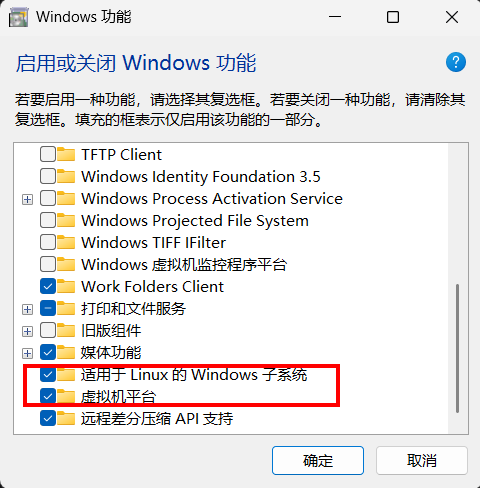

# 安装 WSL（Ubuntu20.04）

## 1. 一键安装（推荐）

前提：Windows 10 版本 2004+ 或 Windows 11。

 打开这些设置 
    

打开cmd

按'win+R'输入'cmd'

执行安装命令

```powershell
wsl --install -d Ubuntu-20.04
```
其中 `Ubuntu-20.04` 里的 `20.04` 是发行版版本号，可按需替换；该命令需要下载并安装完整系统，耗时较长。

设置 Linux 用户名和密码。

注意：密码输入时不显示任何字符，盲打回车即可

安装后更新软件源

```bash
sudo apt update && sudo apt upgrade
```

# 二、删除 WSL

## 1. 彻底清除 WSL

第一步：注销所有的发行版

```powershell
wsl --unregister <发行版名>
```

第二步：卸载 WSL 组件

```powershell
wsl --uninstall
```