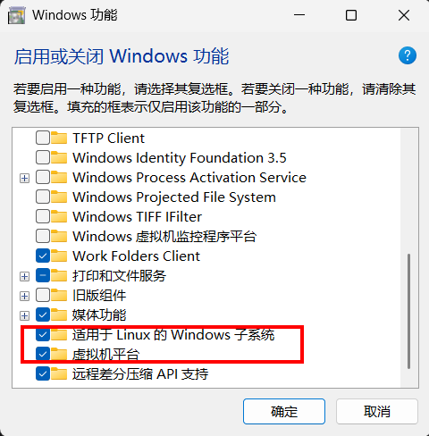

# 安装 WSL（Ubuntu 20.04）

## 1. 一键安装（推荐）

前提：Windows 10 版本 2004+ 或 Windows 11。

 打开「控制面板 → 程序 → 启用或关闭 Windows 功能」，勾选「适用于 Linux 的 Windows 子系统」和「虚拟机平台」两项，点击「确定」，完成后按提示重启电脑。 
    

打开命令行窗口：按 `Win+R`，输入 `cmd` 后回车。

执行安装命令

```powershell
wsl --install -d Ubuntu-20.04
```
其中 `Ubuntu-20.04` 里的 `20.04` 是发行版版本号，可按需替换；该命令需要下载并安装完整系统，耗时较长。

说明：Ubuntu 20.04 LTS 的标准安全维护已于 2025 年 5 月结束。新安装建议使用仍在标准支持期内的 LTS（例如 22.04 或 24.04）；如果课程或软件明确要求 20.04，可以继续使用，但标准软件源不再提供常规安全更新，需要时可通过 Ubuntu Pro 获取扩展维护。版本支持周期见 <https://ubuntu.com/about/release-cycle>。

设置 Linux 用户名和密码。

注意：密码输入时不显示任何字符，盲打回车即可。

安装后更新软件源

```bash
sudo apt update && sudo apt upgrade
```

## 2. 删除 WSL

### 1. 备份需要保留的发行版

`wsl --unregister` 会永久删除指定发行版中的文件、软件和设置。只是暂时不用时，可以先用 `wsl --terminate 发行版名` 停止它；需要清除环境时，先备份再注销。

以下命令在 Windows PowerShell 中执行。先用 `wsl --list --verbose` 查看准确名称，下面以 `Ubuntu-20.04` 为例：

!!! note
    `D:\WSL-Backup` 仅为示例路径，请替换成你想要存放备份的目录。

```powershell
wsl --list --verbose
wsl --terminate Ubuntu-20.04
New-Item -ItemType Directory -Force 'D:\WSL-Backup'
wsl --export Ubuntu-20.04 'D:\WSL-Backup\Ubuntu-20.04.tar'
```

确认导出命令成功结束，再检查备份文件不是空文件。备份路径应放在原发行版之外，并按电脑上的实际盘符修改：

```powershell
Get-Item -LiteralPath 'D:\WSL-Backup\Ubuntu-20.04.tar' | Select-Object FullName, Length
```

重要环境可先导入成另一个名称，验证能启动并查看需要保留的文件。为新副本选择尚未使用的发行版名称和空目录，并预留足够空间：

```powershell
New-Item -ItemType Directory -Force 'D:\WSL\Ubuntu-Backup'
wsl --import Ubuntu-Backup 'D:\WSL\Ubuntu-Backup' 'D:\WSL-Backup\Ubuntu-20.04.tar' --version 2
wsl -d Ubuntu-Backup
```

进入后核对 `/home` 中的项目、配置和数据，完成检查后输入 `exit` 返回 PowerShell。导入的发行版通常默认以 `root` 登录，不代表原用户的文件丢失；恢复默认用户的方法见[微软的导入说明](https://learn.microsoft.com/zh-cn/windows/wsl/use-custom-distro#add-wsl-specific-components-like-a-default-user)。

### 2. 彻底清除 WSL

确认所需文件已有可用备份后，再逐个注销实际要删除的发行版。名称应来自 `wsl --list --verbose`，不要照抄其他机器的名称：

```powershell
wsl --unregister <发行版名>
```

第二步：卸载 WSL 组件

```powershell
wsl --uninstall
```
注意：wsl --uninstall 需要 Microsoft Store 版 WSL 2.0 及以上。如果提示没有该命令，可在「设置 → 应用 → 安装的应用」中先卸载对应的 Linux 发行版，再卸载「适用于 Linux 的 Windows 子系统」组件，然后重启电脑。

备份、恢复和注销命令可参考[微软 WSL 基本命令](https://learn.microsoft.com/zh-cn/windows/wsl/basic-commands)。
